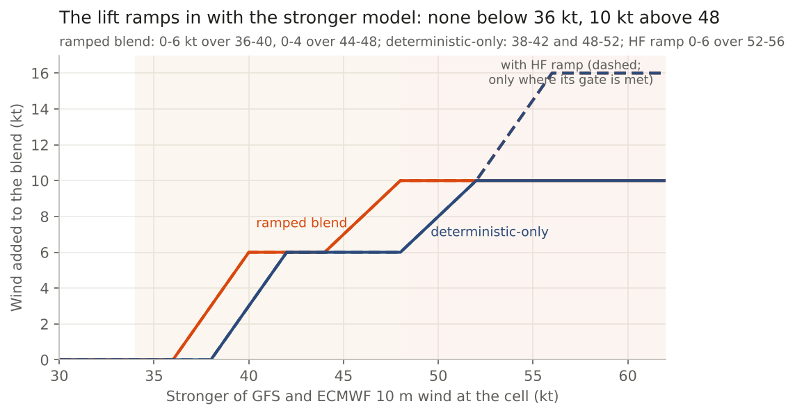
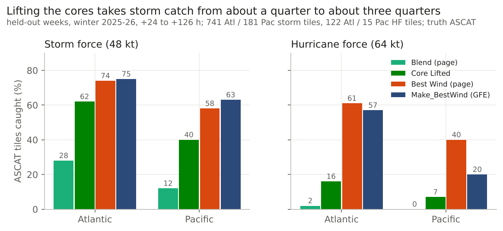
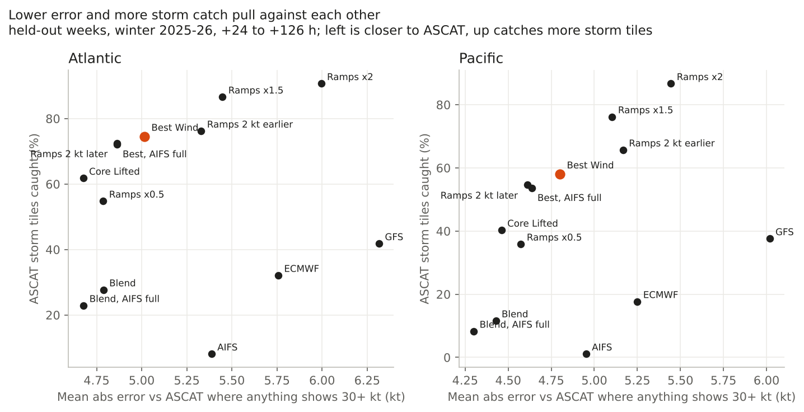
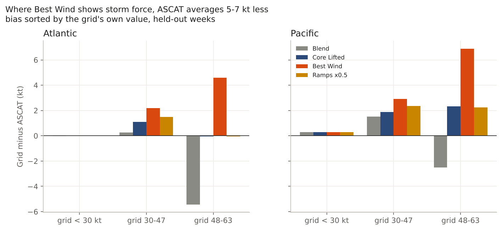
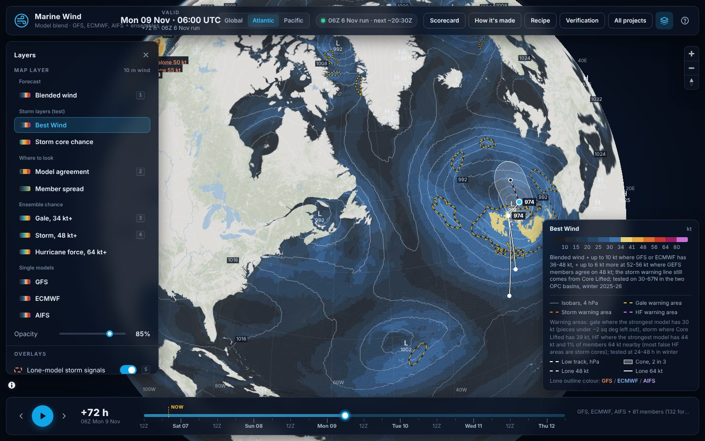

## Abstract

Weather models put ocean storms in about the right place, but their winds in the strongest part of a storm (the *core*) are too weak and too smooth, and averaging models flattens the cores further. We tested, on one winter of forecasts (November 2025 to March 2026) over the North Atlantic and North Pacific, how to build a wind grid that is close to the truth and still shows storm-force and hurricane-force cores. The referee was the ASCAT satellite wind, and every rule was chosen on four fifths of the weeks and scored once on the fifth that was held back.

The result, **Best Wind**, is a model blend with a small lean toward the ensemble spread and a lift of up to 10 kt that ramps in only where the stronger of GFS and ECMWF already shows 36 to 48 kt. Five findings:

1. **It catches the cores.** 74% of ASCAT storm-force tiles in the Atlantic and 58% in the Pacific, against 28% and 12% for the plain blend.
2. **It draws about the right amount** of gale, storm and (Atlantic) hurricane force: 1.05, 0.94 and 0.86 times ASCAT's area.
3. **It does not draw cores in a better place.** No lift can; at equal area every grid caught the same share.
4. **It costs a little accuracy.** About 0.2 to 0.4 kt more average error, and 5 to 7 kt too strong inside its own storm cores.
5. **A good grid is a poor warning line.** The grid carries the *most likely* wind; separate warning lines carry the *possible* wind.

The AWIPS version, Make_BestWind, uses only GFS and ECMWF and scores about the same.

---

## 1. Introduction

The OPC marine desk issues wind grids, warning areas and the High Seas Forecast (HSF) for the North Atlantic and North Pacific. Gale (34 to 47 kt), storm (48 to 63 kt) and hurricane-force (64 kt and above) warnings hinge on the core winds, and a missed storm costs far more than a false alarm.

An average of several models is the best starting wind for most of the ocean, but a poor guide to storm cores: each model puts its core in a slightly different spot, and the average flattens all of them. On day 1 the desk caught 64% of ASCAT storm-force cells, GFS 26% and the plain blend 11%. This report asks:

1. **What wind grid is closest to the truth and still shows the cores the desk must warn for?**
2. **If one grid cannot do both, which job belongs to the grid and which to the warning areas?**

The answer comes from about twenty linked studies (13 October to 7 November 2026). Appendix A gives the order they ran in.

### Key terms

| Term | Meaning in this report |
|---|---|
| Gale / storm / HF | Sustained 10 m wind of 34-47 kt / 48-63 kt / 64 kt or more. HF = hurricane force. |
| Core | The small area of strongest wind near a low. |
| ASCAT | A radar on the Metop satellites that measures wind over the sea from surface roughness. Our referee ("truth"). |
| Blend | A weighted average of the models' 10 m wind speeds at each grid cell. |
| Ensemble spread | How much the ensemble members disagree at a cell, in knots. |
| Lift / ramp | Wind added to the blend in some cells. A ramp grows smoothly with the model wind, so the field has no jumps. |
| Tile | A 5 by 5 degree box. A storm tile is one where ASCAT saw at least one 48 kt cell. |
| Catch | Share of ASCAT storm (or HF) tiles where the forecast also had 48 (or 64) kt in the cells ASCAT saw. |
| False tile | A tile where the forecast had storm force and ASCAT did not. |
| Area ratio | Forecast area at a threshold divided by ASCAT's, over the cells ASCAT saw. 1.0 = the right amount. |
| Equal-area catch | Catch after every grid is set to draw exactly ASCAT's area. It tests *placement* with the amount taken out. |
| MAE / bias | Average size of the miss in knots / average forecast minus truth (positive = too strong). |
| Held-out weeks | Weeks never used to choose a rule; scored once at the end. |

---

## 2. Data and methods

| Item | What was used |
|---|---|
| Period and area | Winter 2025-26 (November to March); both OPC basins, 30-67N, open water. |
| Forecasts | 00Z and 12Z runs, +24 to +126 h, including the 06/18Z valid times where ASCAT passes (most Pacific passes). |
| Models | GFS, ECMWF and the ECMWF AI model (AIFS), 0.25 degree; GEFS, ECMWF ENS and AIFS ENS members. The AWIPS tests use GFS and ECMWF only. |
| Truth | RSS ASCAT 0.25 degree, rain-flagged cells removed, within 90 minutes. A buoy check gave ASCAT -0.3 kt bias, 2.7 kt scatter. Held-out sets: 5.2 million (Atlantic) and 4.0 million (Pacific) cells. |
| Held-out weeks | Fixed on 16 October 2026: an ISO week is held out when (year x 53 + week) is divisible by 5. For this winter: 3-9 Nov, 8-14 Dec, 5-11 Jan, 9-15 Feb, 16-22 Mar. |
| Rules | Each study wrote its decision rule and its pick from the tune weeks before the held-out weeks were scored once. Ranges in brackets resample whole weeks. |
| Scores | Catch and false tiles (storm, HF); area ratio at 34/48/64 kt; equal-area catch; MAE on cells where ASCAT or any grid shows 30+ kt; bias sorted by the grid's own value. |
| Checks | A second, independent agent recomputed the headline numbers from the raw rows; all matched to 0.01. |

Sorting bias by ASCAT's value instead of the grid's makes every grid look 11-13 kt too weak at storm force. That is a statistical trap (regression to the mean), not a real bias, so this report sorts by the grid.

---

## 3. The recipe tested

| Step | Best Wind (web page) | Make_BestWind (AWIPS GFE) | What the step earned (held-out) |
|---|---|---|---|
| Blend | GFS, ECMWF, AIFS at half weight, latest three runs | GFS, ECMWF, latest three runs | Best base for ordinary wind; AIFS at half weight beat full weight by +2 / +8 pts storm catch |
| Spread lean | + 0.25 x member spread, cap 5 kt | + 0.3 x run spread, cap 5 kt | Gale-area bias 0.71 to about 1.0 |
| Storm ramps | 0-6 kt as the stronger of GFS/ECMWF goes 36-40 kt, 0-4 more over 44-48 | Same over 38-42 and 48-52 | Storm catch from about a quarter to three quarters (Section 4.1) |
| HF core | 0-6 kt more over 52-56 kt where 30%+ of GEFS members have 48 kt nearby | Option: same ramp where GFS 925 mb wind x stability >= 55 kt | Draws the right amount of HF (Section 4.2) |
| Gale floor | 34 kt where the gale-core chance is 80%+ | None | Gale area 1.27 to 1.05 (Atl), 1.38 to 1.13 (Pac) |

---

## 4. Results

### 4.1 Best Wind catches the cores

| Held-out, Atlantic / Pacific | Storm tiles caught | HF tiles caught | 30+ kt cell MAE (kt) |
|---|---|---|---|
| GFS | 42% / 38% | 17% / 7% | 6.3 / 6.0 |
| ECMWF | 32% / 18% | 10% / 7% | 5.8 / 5.2 |
| Blend (page) | 28% / 12% | 2% / 0 | 4.79 / 4.43 |
| Core Lifted (old page grid) | 62% / 40% | 16% / 7% | 4.68 / 4.46 |
| **Best Wind (page)** | **74% / 58%** | **61% / 40%** | 5.02 / 4.80 |
| **Make_BestWind (GFE)** | **75% / 63%** | **57% / 20%** | 5.48 / 5.16 (page Best Wind 5.18 / 4.89 on these same cases) |

Best Wind catches about three storm tiles in four in the Atlantic, more than any single model and 12-18 points more than Core Lifted. Its HF catch is 61% against 16%. Make_BestWind matches it at storm force with no ensemble at all, for about 0.2-0.3 kt more error than the page grid on the same cases. Pacific HF rests on 15 tiles.

### 4.2 It draws about the right amount

| Grid area / ASCAT area | Gale (34 kt) | Storm (48 kt) | HF (64 kt), whole winter |
|---|---|---|---|
| Blend alone (page) | 0.85 / 0.81 | (far too little) | 0.00 / 0.00 |
| **Best Wind (page)** | **1.05 / 1.13** | **0.94 / 0.87** | **0.86 / 0.46** |
| Make_BestWind, HF core Off | 0.95 / 1.06 | 1.06 / 1.21 | 0.57 / 0.64 |
| **Make_BestWind, HF core On** | 0.95 / 1.06 | 1.06 / 1.21 | **1.13 / 1.18** |

Atlantic / Pacific. Gale is held-out after the 80% floor; storm for Best Wind is the whole winter; HF is the whole winter (10,203 Atlantic and 228 Pacific ASCAT HF cells), because the held-out weeks hold too few HF cells to judge area.

- Every grid lands within about 15% of ASCAT's gale and storm area.
- Without its HF core, Make_BestWind draws only about half of ASCAT's HF; with it, about the right amount. **Recommendation: HF core On by default** (waits on a check on AWIPS).
- Pacific HF on the page (0.46) is short, but on 228 cells it is a rough guide.

### 4.3 No lift puts the cores in a better place

At equal area, every grid caught the same share:

| Equal-area catch, Atlantic / Pacific | Storm tiles (held-out) | HF cells (whole winter) |
|---|---|---|
| Plain blend | 0.60-0.62 / 0.40-0.42 | 32% / 15% |
| Core Lifted | 0.60-0.62 / 0.40-0.42 | - |
| Best Wind and every variant | 0.60-0.62 / 0.40-0.42 | 31% / 17% |
| Make_BestWind (HF core Off or On) | - | 28% / 9% |

A lift changes a cell's wind using only what the models already show there. If no model has the core in the right cell, no lift can move it there. **Lifts fix the amount, not the place.** Better placement will come only from better models or shorter lead times. That is why a missed core is caught by drawing wider, which is the warning area's job.

### 4.4 The price: a little error, and hot cores

| Held-out, Atlantic / Pacific | 30+ kt cell MAE (kt) | Bias where the grid shows 48-63 kt | Storm tiles caught |
|---|---|---|---|
| Blend, AIFS full weight (lowest error) | 4.68 / 4.30 | -6.2 / -5.0 | 23% / 8% |
| Blend (page) | 4.79 / 4.43 | -5.4 / -2.5 | 28% / 12% |
| Best Wind, ramps half size | 4.79 / 4.57 | 0.0 / +2.3 | 55% / 36% |
| **Best Wind (live)** | **5.02 / 4.80** | **+4.6 / +6.9** | **74% / 58%** |
| Best Wind, ramps 1.5 x | 5.45 / 5.10 | +8.1 / +10.5 | 87% / 76% |

- **Error and catch are one trade.** Each knot of added error buys storm catch along a single curve (Figure 3). Best Wind sits where the gain per knot starts to flatten.
- **No cheaper variant passed.** The rule, set beforehand, was lower error in both basins without losing more than 2 pts of storm catch or any HF catch. AIFS at full weight cut 0.15 kt but lost 2-4 pts storm and 7-13 pts HF; later ramps cut 0.15-0.19 kt but lost 2-3 storm and 7-11 HF; half-size ramps cut 0.23 kt but lost 20-22 storm.
- **Best Wind runs hot inside its own cores** (Figure 4): where it shows 48-63 kt, ASCAT averaged 4.6 kt (Atl) and 6.9 kt (Pac) less. Part of this is the referee: where a second satellite (SMAP) saw the same 48-56 kt cells it read 0.4-2.0 kt higher than ASCAT.

### 4.5 A good grid makes a poor warning line

The storm warning line and HSF storm draft are drawn where a field reaches 39 kt. Drawn from Best Wind instead of Core Lifted (held-out, ASCAT 48 kt with the 60 nm reach):

| Storm warning line | Atl covered | Atl area / ASCAT | Pac covered | Pac area / ASCAT |
|---|---|---|---|---|
| **Core Lifted >= 39 kt (kept)** | 83% | 2.07x | 67% | 3.4x |
| Best Wind field, same coverage | 84% | 2.78x | 70% | 4.8x |

At the same coverage the Best Wind line is 1.35 times wider (Atl) and 1.4 times (Pac). The ramps lift broad near-storm areas, which suits a grid and not a line; the ensemble core likelihood is the better "where" for a warning. So the project uses each field for the job it scores best at:

| Product | Job | Built from | Held-out score |
|---|---|---|---|
| **Wind grid** | Most likely wind | Best Wind / Make_BestWind | Area near 1.0 at 34/48/64 kt; storm catch 74-75% Atl |
| **Gale line** | Possible gale | Strongest model >= 30 kt | Covers about 97% of ASCAT gale |
| **Storm line, HSF storm** | Possible storm | Core Lifted >= 39 kt | 93% at 2.1x area (desk grids 3.6x, issued text 5-6x) |
| **HF line** | Possible HF | Strongest model >= 44 kt with >= 1% of members at 64 kt | 81% of HF lows within 150 km |

### 4.6 What did not help

| Idea | Held-out result |
|---|---|
| Lift the whole grid (not just cores) | Never paid |
| Highest model + ramps as the grid | 1.6-2.9x ASCAT's storm area: a warning rule, not a grid |
| Ensemble core likelihood on top of the ramps | Lost catch at every threshold |
| Mix the 925 mb wind down in unstable air | GFS 10 m already carries 0.81 of it there and is unbiased; lifted cells verified at gale 10% (Atl) / 3% (Pac) |
| 30 m winds or a stability switch | Lost to the 10 m blend everywhere |
| Average bias correction | -4 to -12 pts storm catch |
| Retrained core model; deepening-rate lift; satellite clues for HF | No gain |
| Weighting models by recent skill; wind from the pressure gradient | Worse |
| Machine-learned blend | Did not beat the recipe |

---

## 5. Discussion

**Two products, two jobs.** One field cannot be both the most likely wind and the warning. A grid built to be right on average misses most cores, because the models put them a little off; a grid that reaches them is hot where it draws them. Best Wind takes the middle: it draws about ASCAT's amount of each category, accepts that some of it sits beside the real core, and leaves the wider "possible" to the warning lines. This matches how the desk works: the grid is the forecast, the warning is the hazard.

**Why the cores are weak.** Near hurricane-force lows, GFS and ECMWF had the low's depth within 1-2 hPa on days 1-2, yet the core wind was still 6.1 / 7.3 / 15.9 kt below ASCAT for GFS / ECMWF / AIFS. The lows are deep enough; the wind field is too smooth. That is why a lift tied to the model's own strong wind works, and why fixing the pressure does not.

**What a forecaster should take from this.**

- Read the grid as the most likely wind; read the lines for what is possible.
- Where Best Wind shows storm force, expect ASCAT a few knots lower; where it shows HF, expect the right size of core, possibly 50-100 nm off.
- In strongly unstable air, trust GFS 10 m over ECMWF (ECMWF runs about 4 kt low there); do not mix the 925 mb wind down by rule.
- Spend desk time on storm cores, days 1-2, above all in the Pacific.

---

## 6. Limitations

- **One winter** (November to March). Warm season untested; the core likelihood is weaker March to October.
- **Five held-out weeks.** The ranges are tighter than another winter would allow; one mid-December week holds 37% of the Atlantic storm events.
- **Pacific HF is thin**: 15 held-out tiles, 228 ASCAT cells all winter.
- **ASCAT** reads low in the strongest cores, is blind within 25-30 km of ice and steep coasts (Greenland barrier jets), and has had an outage at RSS since 12 October 2026.
- **Make_BestWind** has not yet run on Jason's AWIPS; some grid names are guesses.
- **Untested:** subtropics, tropical cyclones, fast bombs with a 12-18 h timing split between model families, CMC and UKMET.

---

## 7. Conclusion

A plain blend is the best wind on an ordinary day and the worst guide to a storm core. Best Wind keeps the blend, leans a little toward the spread, and ramps in up to 10 kt (16 kt with the HF core) only where a model already shows a strong core. It catches about three quarters of ASCAT storm tiles in the Atlantic and six in ten in the Pacific while drawing close to ASCAT's area at gale, storm and hurricane force, for a few tenths of a knot of average error. No lift draws cores in a better place, so the wider "possible" belongs in the warning lines, which stay on their own tested rules. The test is next winter: does the desk warn more accurately, over smaller areas, in less time.

---

## References (studies in jkrek17/marine-research unless noted)

| # | Study | Location | Pull requests |
|---|---|---|---|
| 1 | Wind blend experiment (13 Oct) | `/mnt/project-files/wind-focus/experiment/` | - |
| 2 | ASCAT as referee; stability and 30 m winds; Core Lifted (15 Oct) | `/mnt/project-files/wind-focus/ascat/`, `stability30m/`, `core/` | - |
| 3 | AIFS in the blend | `studies/2026-10-16-aifs-in-blend/` | - |
| 4 | Desk added value | `studies/2026-10-16-desk-value/` | - |
| 5 | Storm-force truth (SMAP vs ASCAT) | `studies/2026-10-16-storm-force-truth/` | - |
| 6 | Warning forecast experiment | `studies/2026-10-16-warning-forecast/` | - |
| 7 | Gale cores | `studies/2026-10-17-gale-core/` | - |
| 8 | Too shallow or too smooth (HF depth) | `studies/2026-10-18-hf-depth/` | - |
| 9 | Bias correction on Core Lifted | `studies/2026-11-05-core-lift-bias/` | #70 |
| 10 | Strong-core lift | `studies/2026-11-06-strong-core-lift/` | #73 |
| 11 | Best GFE grid wind tool (ramps, HF core, page ramps, warning lines) | `studies/2026-11-06-gfe-wind-tool/` | #78, #84, #85, #87, #90, #91, #96 |
| 12 | 925 mb mix-down | `studies/2026-11-06-925-mixdown/` | #97 |
| 13 | The wind grid as a most-likely wind (gale floor, GFE scoring, HF amount over the whole winter) | `studies/2026-11-07-most-likely-wind/` | #98, #99, #100, #101 |
| 14 | Make_BestWind, Best Wind page layer, 80% gale floor | jkrek17/awips-tools | #157, #158, #162 |
| 15 | The forecast recipe page | awips-tools `marine_wind/page/recipe/` | - |

Every number comes from the findings file of the study it belongs to; the dead-end list draws also on the studies listed in `STUDIES.md`. The two new figures list their numbers and source in a CSV beside the image.

## Appendix A: how the work ran

| Date | Step | Outcome |
|---|---|---|
| 13 Oct | Blend + spread lean | Restored gale area (0.71 to ~1.0) |
| 15-17 Oct | Core Lifted: +5 kt where storm-core likelihood >= 35%; 34 kt where gale-core chance >= 60% | Storm catch 15 to 49%; gale +13 / +12 pts |
| 18 Oct | Why cores are weak | Too smooth, not too shallow |
| 5 Nov | Bias correction | Core Lifted short of storm area (0.72 / 0.51) |
| 6 Nov | Ramps on the stronger of GFS/ECMWF (GFE, then page); HF core | Storm 75% Atl at about ASCAT's area; Make_BestWind built |
| 6 Nov | Warning line re-score | Line stays on Core Lifted; Best Wind becomes the page grid |
| 7 Nov | Scored as a most-likely wind | Kept; gale floor raised to 80%; HF core On recommended |
