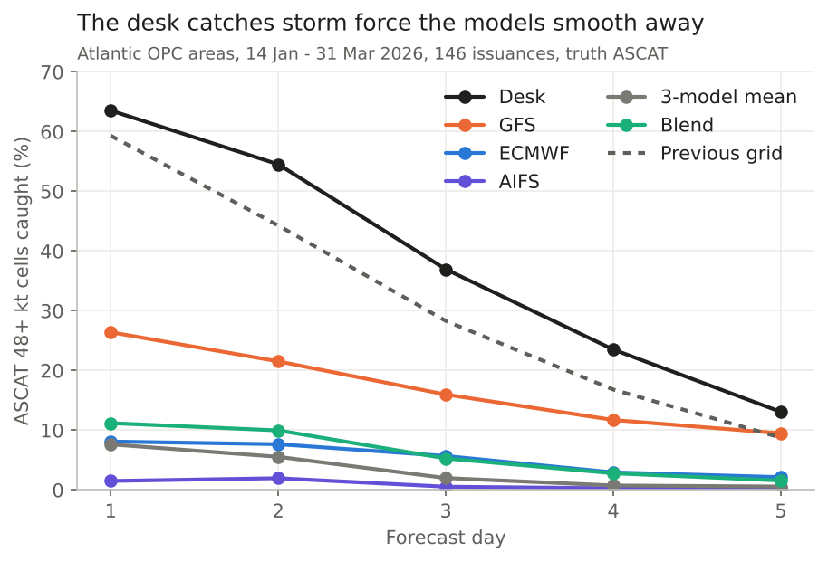
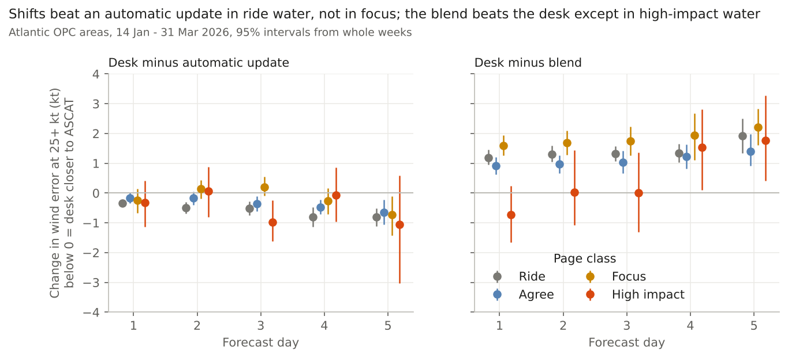

# Desk added value: findings

*2026-10-16 · both basins, OPC High Seas Forecast areas only · desk grids 14 Jan - 31 May 2026 (276 model cycles, 21 weeks; winter = 14 Jan - 31 Mar, 146 Atlantic issuances) · truth: ASCAT (real 10 m, Metop B/C met halfway) · every number below is from `results/`, recomputed by a second agent from the row tables.*

## The answer
- **Each shift makes the grid better than the one it started from, and better than an automatic update.** In the winter weeks the desk's grid is 0.25-0.7 kt closer to ASCAT than the previous grid moved by the change in the models (Atlantic, days 1-5), 0.5-1.4 kt in the Pacific, every interval clear of zero. The forecaster adds something the newer model runs alone do not.
- **The desk's real value is storm force.** Atlantic winter, ASCAT 48+ kt cells caught on day 1 / day 2: desk 64% / 55%, GFS 26% / 22%, blend 11% / 10%, ECMWF 8% / 8%, 3-model mean 8% / 6%, AIFS 2% / 2%. The desk pays for it with more false alarms (33-41% of its storm-force cells vs 13-26% for GFS), and still has the best critical success index (.48 / .40 vs GFS .25 / .20). The desk lifts the cores the models smooth away, the same thing Core Lifted does.
- **On wind speed in ordinary water the models beat the desk.** The blend is 1.0-1.9 kt closer to ASCAT than the desk's final grid (Atlantic winter, days 1-5) and the 3-model mean 0.9-1.4 kt; GFS 0.25-0.45 kt on days 1-2. The desk reads about 2 kt high in its 25+ kt areas on days 1-2; the models read low.
- **Routine vs attention.** In winter 85% of the water is ride (all three models under 30 kt), 9% agree, 5% focus and under 0.5% high impact (0.2% counting cells, 0.5% averaging grid by grid). 83% of the desk's edits (cells moved more than 2 kt) fall in ride water; each shift edits 38% of it, by 2.3 kt on average. Those edits beat the automatic update but the blend beats them by 1.2-1.9 kt. In focus water (5% of the water, 7% of the edits, 58% of it edited each shift) the desk is no better than the automatic update and the edits move toward ASCAT half the time. Only in high-impact water does the desk match or beat the blend on days 1-3, and there it is 1.6 kt closer than GFS over days 1-5 (mostly days 3-5; days 1-2 not clear of zero, 54-62 issuances).

**For the yardstick:** most desk time goes into ride water, where a blend first guess is already better than the finished grid. That time could move to high-impact water, where the desk is the only method that catches storm force. Focus water, where the models disagree, is where the desk does not yet beat the models or an automatic update; that is where better guidance (chances, ensemble spread) should help most.

## The evidence
Wind error at 25 kt and up against ASCAT (kt; cells where forecast or ASCAT reach 25 kt), desk minus each method, the same issuances and valid times (day 1 = 1-24 h after the model cycle), 95% intervals from resampling whole weeks. Negative = desk closer to ASCAT. Winter = 14 Jan - 31 Mar 2026.

| Desk minus | Basin | Day 1 | Day 2 | Day 3 | Day 4 | Day 5 |
|---|---|---|---|---|---|---|
| Previous grid | Atlantic | -0.23 [-0.31,-0.15] | -0.37 [-0.50,-0.26] | -0.56 [-0.69,-0.45] | -0.60 [-0.78,-0.40] | -0.75 [-1.08,-0.46] |
| Previous grid | Pacific | -0.21 [-0.37,-0.07] | -0.31 [-0.50,-0.16] | -0.42 [-0.58,-0.28] | -0.52 [-0.71,-0.32] | -0.49 [-0.61,-0.35] |
| Automatic update | Atlantic | -0.25 [-0.36,-0.15] | -0.31 [-0.47,-0.17] | -0.39 [-0.52,-0.27] | -0.40 [-0.57,-0.23] | -0.69 [-0.91,-0.49] |
| Automatic update | Pacific | -0.56 [-0.80,-0.35] | -0.46 [-0.84,-0.11] | -0.48 [-0.86,-0.08] | -0.51 [-0.83,-0.16] | -1.44 [-2.22,-0.67] |
| GFS | Atlantic | +0.44 | +0.25 | +0.06 | -0.20 | +0.09 |
| ECMWF | Atlantic | +0.44 | +0.40 | +0.25 | +0.06 | -0.03 |
| 3-model mean | Atlantic | +0.90 | +0.94 | +0.93 | +0.95 | +1.36 |
| Blend | Atlantic | +1.02 | +1.12 | +1.19 | +1.33 | +1.86 |
| Blend | Pacific | +1.37 | +1.62 | +1.34 | +1.47 | +1.00 |

Model rows: intervals clear of zero except GFS days 3-5 and ECMWF days 3-5 in the Atlantic (all in `results/paired.csv`). Pacific model rows rest on 40-86 issuances (models stored at 00/12Z valid, Pacific ASCAT mostly 06/18Z).

By page class, Atlantic winter, days 1-5 (`results/paired.csv`):

| Class | Share of water / of edits | Edited each shift | Edits toward ASCAT | Desk minus automatic update | Desk minus blend |
|---|---|---|---|---|---|
| Ride | 80% / 75% | 38% | 56% | -0.6 kt, clear of zero all 5 days | +1.4 kt, all 5 days |
| Agree | 12.5% / 14% | 45% | 54% | -0.4 kt, 3 of 5 days | +1.1 kt, all 5 days |
| Focus | 7% / 10% | 58% | 50% | -0.2 kt, 1 of 5 days | +1.8 kt, all 5 days |
| High impact | 0.4% / 0.7% | 64% | 57% | -0.5 kt, 1 of 5 days | +0.5 kt; -0.7 to 0.0 on days 1-3, not clear of zero |

Both basins together: ride 85% of the water and 83% of the edits, focus 5% and 7%, high impact 0.2-0.5% and 0.3%. "Toward" counts edited cells ASCAT saw where the edit moved the grid closer to ASCAT; against the automatic update instead of the previous grid the share is 42% toward and 35% away in ride, 43% and 45% in focus.

**April-May** (quiet season, no ensembles in the store so no blend): ride is 96% of the water; desk minus automatic update 0.0 to -0.4 kt (Atlantic, clear of zero days 3-5), desk minus 3-model mean +0.65 to +1.14 kt; storm force caught desk / GFS / 3-model mean 29% / 9% / 2% (Atlantic) and 43% / 32% / 7% (Pacific).

## What it does not show
- **Pacific storm force is unscored**: 72 ASCAT 48+ kt cells per lead in the matched Pacific winter sample, too few.
- **OPC water is in the archived desk grids only from 13 Jan 2026**, so there is one winter half (11 weeks).
- **Average error rewards smooth fields.** Wind error at 25 kt and up picks more cells for a method that runs high; on cells where ASCAT itself is 25+ kt the ordering is the same (blend 2.7 kt, 3-model mean 2.9, GFS 3.0, desk 3.3 on day 1), and the desk's high reading turns into a low reading from day 3.
- No Core Lifted column (its Atlantic training winter is this winter, so it would be in-sample), no situations table and no sorting of edits by kind; those are the next steps if wanted.
- The automatic update starts from the desk's own previous grid, so it already carries earlier shifts' storm lifts.

## How it was done
- Desk grid: NDFD oceanic wind speed (YCYZ98 days 1-3, YCYZ97 days 4-7), averaged onto 0.25 deg (`rk.desk`, with alternative row scanning undone). The Atlantic's update after the 00Z/12Z runs lands in the ~10Z/22Z snapshots, the Pacific's in the ~13Z/01Z snapshots (`rk.desk.issue_for`). Previous grid = the previous update; automatic update = previous grid + (3-model mean now minus 3-model mean 12 h earlier) at the same valid time; blend = 3-model mean + 0.25 x member spread (0.15 on day 1), capped at 5 kt, the page recipe.
- Truth: ASCAT (`rk.truth.ascat`, rain dropped), OPC High Seas Forecast areas only (`rk.basins.opc_mask`). Classes: the marine wind page rule (`rk.classes`, identical to the page's `focus_grid`).
- Code: `score.py`, `summarize.py`, `figures.py`; tables and figures in `results/`; row tables in the shared folder `research-data/extra/desk-value/`.
- Checked by: a second agent recomputed the headline numbers from the row tables without reading the summary code or this write-up: every winter number matched within 0.02 kt once valid times were matched before pairing; it flagged the high-impact water share (0.2% by cells, 0.5% grid by grid) and the thin high-impact and Pacific samples, both stated above. An earlier check caught that the April-May 3-model-mean range was overstated and that the `toward`/`away` columns count all ASCAT cells, not only edited ones (the shares above use the edited-cell columns).
