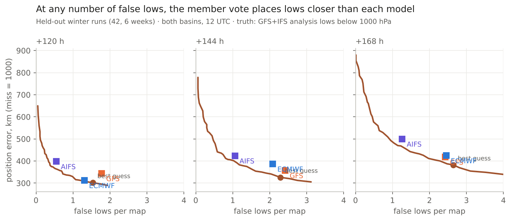
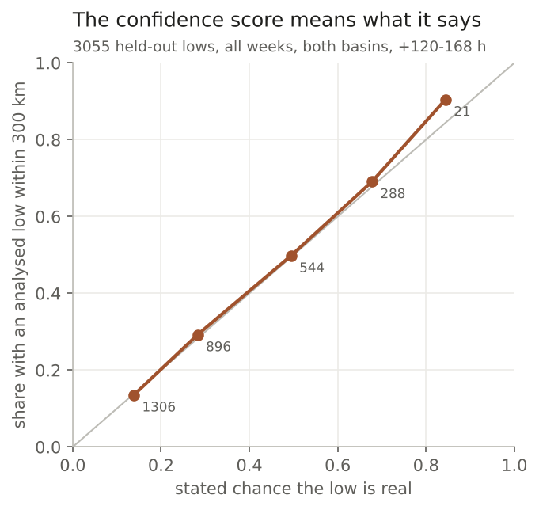
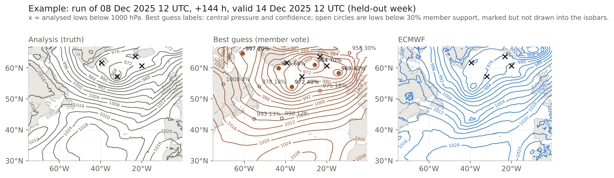

# Day 5-7 lows: a member vote places and deepens lows better than GFS, ECMWF and AIFS at day 6-7

*2026-10-16 · N Atlantic and N Pacific 30-67N, 12 UTC runs · full year added 2026-10-16 22Z: 17 held-out weeks Mar 2025-Oct 2026, ~640 analysed lows per lead (winter alone: 6 weeks, ~350 lows) · truth: anl (GFS+IFS analysis mean)*

## The answer
For days 5-7, let every ensemble member and model vote for the lows it has, and keep a low where enough of them agree. Place it at the average of the members' own low positions, and give it the median of their own central pressures. On held-out winter weeks at day 6-7 this puts lows **46-63 km closer than ECMWF**, with central pressure **2.5-2.8 hPa closer**. It also beats GFS on central pressure (2.6-4.0 hPa), but on position only at day 7 (39 km); at day 6 the 33 km gain is within the noise. It draws 0.2-0.3 more false lows per map than ECMWF, and about one more than AIFS, which draws the fewest. Held to AIFS's false-low count, the vote still places lows 23-39 km closer than AIFS, and its central pressure is 0.5-1.5 hPa closer at day 5 and day 7 (no clear difference at day 6). At day 5 it ties ECMWF on position and finds slightly fewer lows within 300 km (51% against 58%), but wins on central pressure (1.8 hPa). Each low carries a confidence that means what it says: lows stated at 50% verified 50% of the time.

The averaged ensemble map is not the answer. It fills lows (10 hPa too shallow by day 7) and has a low within 300 km of only 22-32% of analysed lows.

## Full year (added 2026-10-16 22Z, same locked settings)
With every held-out week from Mar 2025 to Oct 2026 scored (17 weeks, 630-645 analysed lows per lead), keep thresholds and confidence fit frozen from `results/final.json`, the vote beats all three models at every lead, day 5 included. Vote minus model, 95% interval from resampling whole weeks (`results/final_fullyear.md`):

| Lead | Model | Position km: model, vote minus model | Central pressure error hPa: model, vote minus model | Found within 300 km: model / vote | False lows per map: model / vote |
|---|---|---|---|---|---|
| +120 | ECMWF | 316, −26 [−59, −1] | 6.0, −1.5 [−2.0, −1.0] | 57% / 56% | 0.79 / 0.86 |
| +120 | GFS | 339, −49 [−75, −28] | 6.6, −2.2 [−2.5, −1.8] | 50% / 56% | 1.11 / 0.86 |
| +120 | AIFS | 359, −69 [−105, −38] | 5.2, −0.7 [−1.1, −0.4] | 52% / 56% | 0.33 / 0.86 |
| +144 | ECMWF | 364, −58 [−83, −36] | 7.3, −1.9 [−2.5, −1.2] | 48% / 52% | 1.18 / 1.20 |
| +144 | GFS | 382, −76 [−123, −39] | 8.2, −2.8 [−3.5, −2.3] | 45% / 52% | 1.40 / 1.20 |
| +144 | AIFS | 391, −85 [−115, −55] | 6.2, −0.9 [−1.3, −0.4] | 43% / 52% | 0.62 / 1.20 |
| +168 | ECMWF | 413, −54 [−83, −28] | 9.2, −2.6 [−3.1, −2.1] | 42% / 41% | 1.44 / 1.50 |
| +168 | GFS | 436, −77 [−126, −43] | 10.0, −3.5 [−4.4, −2.4] | 38% / 41% | 1.63 / 1.50 |
| +168 | AIFS | 459, −100 [−122, −80] | 8.0, −1.5 [−2.1, −1.0] | 34% / 41% | 0.76 / 1.50 |

Over the full year the vote draws about as many false lows as ECMWF (0.02-0.07 more per map), fewer than GFS, and two to two and a half times as many as AIFS. Held to each model's own false-low count, it is still closer on position (ECMWF by 26-51 km, GFS by 56-89 km, AIFS by 20-55 km; against AIFS the interval excludes zero at day 7 only) and on central pressure (0.5-3.5 hPa, all intervals exclude zero). Deep lows (below 980 hPa, 84-94 per lead): 59-117 km closer than ECMWF at day 6-7 and 2.9-3.5 hPa closer in central pressure; at day 5 the gain over ECMWF is within the noise. Confidence on 4,810 held-out lows: stated 0-20% verified 13%, 20-40% 29%, 40-60% 51%, 60-80% 72%, 80-100% 93% (29 lows).

The winter-only section below is the first result and stands; the full year says the same, with day 5 now a clear (smaller) win over ECMWF.

## The evidence
Held-out winter weeks, both basins, analysed lows below 1000 hPa. Position error counts a missed low (nothing within 1000 km) as 1000 km. Difference = vote minus model, with a 95% interval from resampling whole weeks; * = interval excludes zero.

| Lead | Model | Position km: model, vote minus model | Central pressure error hPa: model, vote minus model | Found within 300 km: model, vote minus model | False lows per map: model, vote minus model |
|---|---|---|---|---|---|
| +120 | ECMWF | 312, −9 [−55, +20] | 6.8, −1.8 [−2.9, −1.2]* | 58%, −7 [−10, −2]* | 1.3, +0.2 [+0.0, +0.3]* |
| +120 | GFS | 343, −41 [−83, −13]* | 7.4, −2.4 [−2.8, −2.2]* | 52%, −1 [−6, +5] | 1.8, −0.3 [−0.6, +0.0] |
| +120 | AIFS | 398, −95 [−151, −55]* | 5.7, −0.8 [−1.6, −0.3]* | 45%, +6 [+1, +13]* | 0.6, +1.0 [+0.7, +1.2]* |
| +144 | ECMWF | 387, −63 [−103, −37]* | 8.4, −2.5 [−3.3, −1.8]* | 43%, +6 [+3, +12]* | 2.1, +0.2 [+0.1, +0.3]* |
| +144 | GFS | 357, −33 [−93, +2] | 8.5, −2.6 [−3.6, −1.8]* | 48%, +1 [−8, +12] | 2.4, −0.1 [−0.3, +0.1] |
| +144 | AIFS | 424, −100 [−153, −62]* | 6.7, −0.8 [−1.6, −0.2]* | 38%, +11 [+1, +22]* | 1.1, +1.2 [+0.9, +1.7]* |
| +168 | ECMWF | 424, −46 [−82, −21]* | 10.1, −2.8 [−3.3, −2.2]* | 40%, −4 [−8, +1] | 2.5, +0.3 [−0.2, +0.7] |
| +168 | GFS | 418, −39 [−97, −1]* | 11.3, −4.0 [−5.8, −2.0]* | 39%, −4 [−10, +6] | 2.4, +0.3 [+0.0, +0.5]* |
| +168 | AIFS | 500, −121 [−155, −96]* | 9.3, −2.0 [−3.0, −1.4]* | 28%, +8 [+4, +12]* | 1.3, +1.4 [+1.1, +1.8]* |

**At the same number of false lows.** The vote's keep threshold was set (on training weeks) to draw as many false lows as ECMWF. On held-out weeks it drew 0.2-0.3 more per map than ECMWF and about 1 more than AIFS, which draws the fewest lows. So the vote was also held at each model's own false-low rate. Its position error was then lower than every model's at every lead (ECMWF by 2-45 km, GFS by 29-48 km, AIFS by 23-39 km), but the interval excludes zero in only 6 of the 9: not against ECMWF at +120 h or GFS at +144/+168 h. Central pressure error was lower by 0.4-4.1 hPa, clearly in 8 of 9 (not against AIFS at +144 h) (`results/equal_false_lows_heldout_check.csv`; that check sets the threshold on the held-out weeks themselves, so it is a check, not a tuned setting).

**Deep lows (below 980 hPa, 65-75 per lead):** closer than ECMWF by 76-130 km at day 6-7 and 3.2-4.1 hPa closer in central pressure. Against AIFS, 67-117 km closer at day 5-7, with no clear difference in central pressure. These rest on 65-75 lows per lead in 6 weeks.

**Confidence score.** Chance that an analysed low is within 300 km, from the share of members carrying the low, how tightly they cluster, lead and depth. On 3,055 held-out lows from all held-out weeks (not only winter): stated 14% → 14% verified; 28% → 29%; 50% → 50%; 68% → 69%; 84% → 90% (21 lows).

## Spread for the map (check added 2026-10-16, Jason asked for a measure of spread)
Rules fixed before running (`preregistration.md`); results in `results/spread_check.md`. Held-out lows from all held-out weeks Mar 2025-Mar 2026, about 880 per lead with an analysed low within 1000 km.

- **Depth range works.** Widen the members' own 10th-90th percentile central pressures by about 1.4 and the range holds the analysed pressure 81-82% of the time. It is 16-20 hPa wide in the middle, and a wide range really does mean a less certain depth: the median error is 2.7-3.5 hPa for the tightest third of lows and 4.6-7.4 hPa for the widest third. Label: "L 978 (970-990) 62%".
- **Position spread does not.** The members' centres cluster 2-4 times too tightly, so an ellipse has to be scaled up. Once scaled, the 50% ellipse holds half the analysed lows, but its size says little about which low is uncertain: the median error is 320/301/349 km for the tightest/middle/widest third at +120 h, and much the same at +144 and +168 h (correlation about 0.1). The 90% ellipse failed its preregistered mark (74-77%) because the errors are heavy-tailed; refitting it on its own holds 89-92% but makes it about 1000 km across, the size of the miss cap. A per-low ellipse would look informative without being so.
- **What to draw instead:** one ring per lead for where the centre will be half the time (about 320 / 370 / 410 km at +120 / +144 / +168 h), plus member centres on request so a split shows. Whether the low is real stays with the confidence score.

## What it does not show
- The full-year table re-scores with the winter-locked thresholds; `results/comparisons.csv` and the figures are still the winter run (`final.md`).
- Only 6 held-out winter weeks, so the week-resampled intervals are rough and probably a little narrow. They are wide at +120 h against ECMWF, and for deep lows.
- Position error counts a miss as 1000 km, so it mixes finding a low with placing it. The "found within 300 km" column shows the finding part on its own.
- 12 UTC runs only, +120/+144/+168 h, 30-67N. Not the field as a whole: Jason asked for lows, so overall pressure error was not scored.
- The best-guess map draws lows only where at least 30% of the weighted members agree. Weaker lows are listed with their confidence, not drawn. The map's look (the aligned average around each low) was checked by eye, not scored.
- AIFS ENS starts in Aug 2025, so the earliest training runs vote without it.

## How it was done
- Truth: lows in the GFS+IFS analysis mean (13x13-cell minima, below 1000 hPa, 3 degrees inside the box). `rk.score.find_lows`.
- Baselines: GFS, ECMWF IFS and AIFS runs; the grand ensemble mean.
- Vote: each GEFS/ENS/AIFS ENS member votes for its own lows below 1008 hPa (each ensemble counts as one block); GFS, ECMWF and AIFS runs vote with weight 0.3 each. A low is kept where at least the keep threshold of the weighted voters have a low within 450 km; threshold 0.12 / 0.14 / 0.16 at +120 / +144 / +168 h. Things that did not help: lagged runs, a depth calibration (it pushed lows below 1000 hPa and added false lows), heavier model weights.
- Cases: 12 UTC runs, Mar 2025-Oct 2026 (winter complete). Held-out weeks are `rk.cases.held_out`; tuning also dropped runs whose valid day fell in a held-out week. Settings were locked before scoring (`preregistration.md`).
- Code: this folder (`download.py`, `method.py` vote, `bestguess.py` map, `final.py` score, `report.py` tables and figures). Data: every member's MSLP, local cache `RK_CACHE/extra/mslp-d5-7`; publishing to the release store follows once the pull is complete.
- Checked by: an independent agent recomputed every held-out winter row of `results/comparisons.csv` from the raw per-low tables (all 84 match), redid the week resampling for the position rows (agrees within ~5 km), and checked the confidence and equal-false-low numbers. Its wording corrections are applied (`results/check.md`).
