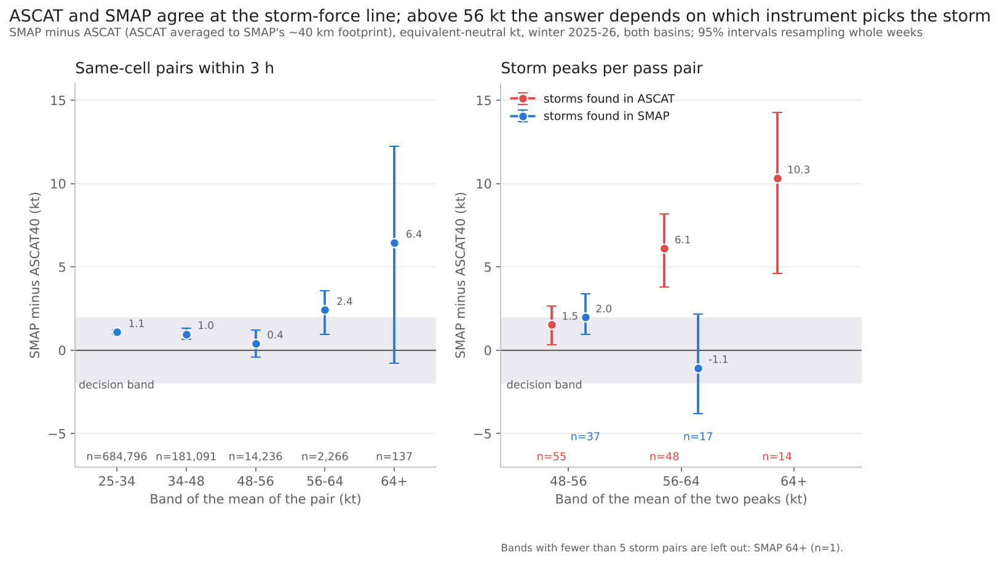

# Storm-force truth: ASCAT against SMAP, buoys and ships

*2026-10-16 · North Atlantic and North Pacific, 30-67N · winter 2025-26 (1 Nov - 31 Mar, 151 days) · truth: no single truth; two independent instruments (ASCAT, SMAP) and buoys/ships*

## The answer
Two instruments do not settle storm-force truth. At 48-56 kt ASCAT and SMAP are close: same-cell pairs agree to 0.4 kt (interval -0.4 to +1.2), and storm peaks put SMAP 1.5-2.0 kt higher. That storm-peak gap is the comparison the design set as the test, and its interval reaches past the ±2 kt band, so the pre-set rule is **not** passed. Nothing here shows ASCAT is wrong at the 48 kt line by more than about 2 kt, so it stays the referee by default, not by a passed test, and no adjustment goes into the kit. Above 56 kt the two instruments diverge and the answer depends on which one picks the storm; at hurricane force there are too few pairs to say anything.

## The evidence
SMAP minus ASCAT, equivalent-neutral kt. ASCAT is averaged to SMAP's ~40 km footprint first. Bands are on the mean of the two readings. Both basins pooled.

| Band (mean of pair) | Same-cell pairs within 3 h | Storm peaks, storms found in ASCAT | Storm peaks, storms found in SMAP |
|---|---|---|---|
| 48-56 kt | +0.4 [-0.4, +1.2], 14,236 cells | +1.5 [+0.3, +2.6], 55 pairs | +2.0 [+0.9, +3.4], 37 pairs |
| 56-64 kt | +2.4 [+1.0, +3.6], 2,266 cells | +6.1 [+3.8, +8.2], 48 pairs | -1.1 [-3.8, +2.2], 17 pairs |
| 64+ kt | +6.5 [-0.8, +12.2], 137 cells, 8 weeks | +10.3 [+4.6, +14.3], 14 pairs | n/a (1 pair) |
| All 25+ kt | +1.05 [+0.89, +1.20], 882,526 cells | | |

*Intervals: 95%, resampling whole weeks, all weeks. 17 storm-passes were found both ways, so the two storm columns are not independent.*

- **Same-cell pairs** are the comparison least affected by how storm peaks are sampled, but they still depend on both readings exceeding 25 kt and are up to 3 h apart. Their offset climbs with speed (+0.4, +2.4, +6.4 kt), which is consistent with ASCAT reading low at the top end, or SMAP reading high there; this study cannot tell which.
- **Storm peaks depend on which instrument picks the storm.** Picked by ASCAT, SMAP's peak is higher; picked by SMAP, it is level or lower above 56 kt. This fits two sampling effects that were not separated: the other instrument's peak is the maximum of 300-450 cells in a 300 km disk, and the picking instrument was selected on one high reading. Where SMAP picked a storm and the pair's mean is below 48 kt (18 pairs, not in the table), SMAP reads 13 kt higher, which shows how large selection can be.
- **The two basins differ at 48-56 kt.** Storm peaks: Atlantic +0.8 [-0.9, +2.9] (ASCAT-picked), Pacific +2.8 [+1.3, +5.0] (ASCAT-picked) and +2.4 [+1.1, +4.6] (SMAP-picked). The pooled number averages two different answers.
- **Held-out weeks** (5 weeks) are consistent in sign but too few to confirm or contradict: ASCAT-picked 48-56 +2.2 [+0.05, +3.3], 56-64 +4.6 [-2.1, +10.2], 64+ +8.1 [-1.5, +13.9]. Same-cell 48-56 on held-out weeks is -0.4 [-1.6, +1.1].
- **Neither instrument is validated at 48 kt or more**: there is no buoy or ship pair there for either. At 25-34 kt ASCAT reads 1.7 [1.5, 2.0] kt below buoys (151 pairs) and 4.2 kt below ships (48); SMAP reads about 4 kt above obs (10 pairs, too few to lean on). At 34-48 kt ASCAT minus all obs is 0.0 [-2.1, +1.7] (32 pairs).
- **Rain.** Of the SMAP 48+ kt cells that ASCAT also passed within 3 h (18,870, about a quarter of all SMAP 48+ cells), 15.8% [12.0, 19.3] carried an ASCAT rain flag and so are dropped from every ASCAT score: Atlantic 13.6% [9.5, 17.9], Pacific 22.8% [12.8, 35.9] (the basins are not distinguishable). ASCAT itself still read a median 51 kt in those cells. Whether that sea really was storm force rests on SMAP being right in rain, which is not tested here.

## What it means for other numbers
- **The 48 kt line**: storm-force counts, chances and the core lift's out-of-sample storm catch (about 38% of ASCAT storm boxes, verification page thread) stand as scored, with an uncertainty of up to about 2 kt in the truth itself. By the noise study's rule of thumb (1 kt moves the 48 kt frequency about 17%), that is a real but bounded uncertainty in every storm-force count.
- **Rain-flagged storm force** is invisible to ASCAT scores. A rain-aware truth (keep ASCAT's rain-flagged 48+ cells where SMAP agrees) is a follow-up worth testing, not a result.
- **Hurricane force is open.** Any HF verification against ASCAT should say so.
- **The decision.** The adjustment rule (offset above 2 kt at 48-64, same sign in both basins and on held-out weeks) is arguably met for ASCAT-picked storms at 56-64 kt but not for SMAP-picked storms. Not fitting an adjustment because the sign flips with the picking instrument is a judgement made after seeing the results, not a pre-set rule.

## What it does not show
- Which instrument is right above 56 kt. SMAP's own high-wind calibration (per RSS's published description) comes from tropical cyclones, not winter lows.
- Same-cell pairs are up to 3 h apart, so storm motion adds scatter, though not a sign.
- Only 2 storm pairs are within 90 min of each other; the time-gap split carries no information.
- Spring, autumn and summer; latitudes outside 30-67N.

## How it was done
- **Instruments**: ASCAT RSS v2.1 (`rk.truth.ascat_day`, rain dropped unless counted, Metop-B/C intercalibrated halfway) averaged to a ~40 km footprint (3 x 3 same-pass weighted mean); SMAP RSS v1.0 FINAL daily (`rk.truth.smap_day`, new in this study). Both equivalent-neutral 10 m wind.
- **Method 1**: storm objects (connected 40+ kt with a 48+ peak) in one instrument, the other's pass within 3 h, peaks within 300 km; both directions.
- **Method 2**: same 0.25 deg cell, both readings within 3 h (and within 90 min, high latitudes only: 9,152 cells, +2.2 [+1.7, +2.7] overall, too few above 48 kt).
- **Method 3**: GDAS marine buoys and ships (`rk.truth.obs`; Atlantic 12 UTC, Pacific 00 UTC cycles), within 30 min and 25 km.
- **Method 4**: SMAP 48+ cells against ASCAT's rain flag at the same cell within 3 h.
- **Decision rule set before running** (`design.md`): storm-peak offset within ±2 kt at 48-64 kt, interval inside the band, and ASCAT stands. Not met: at 48-56 kt the storm-peak intervals reach +2.6 and +3.4. ASCAT stays by default; see "The decision" above.
- **Code**: `compare.py`, `obs_fill.py`, `obs_pairs.py`, `summarize.py`; tables in `results/`. Data: the shared store (`truth/ascat`, `truth/smap`, `truth/obs`).
- **Checked by**: an independent agent recomputed the storm-peak table from `storm_pairs.csv` (means and counts exact; intervals within 0.2 kt, different seed) and checked every other number against the CSVs. One wrong number was fixed (SMAP had 10 obs pairs, not 63). It also found the pre-set rule had been misapplied in the first draft and the rain share worded as a floor; both corrected here.
