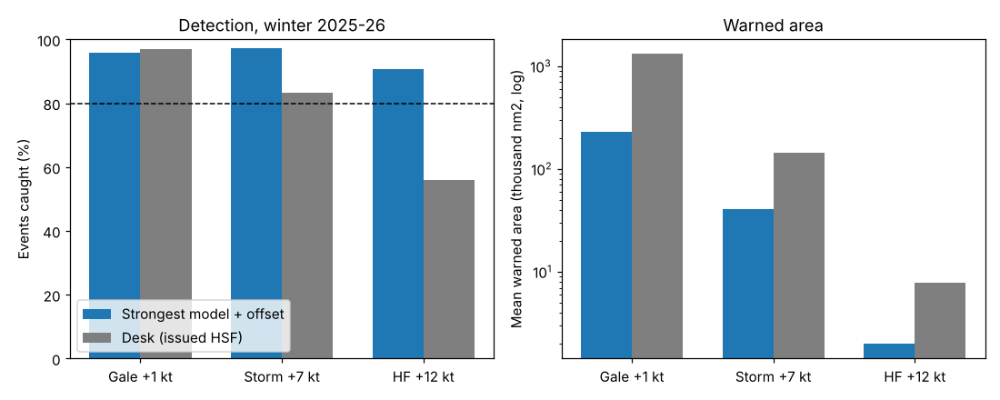

# Warning forecast experiment

*2026-10-16 · Atlantic and Pacific high seas areas, 00 and 12 UTC · winter 2025-26 (1 Nov to 31 Mar), 24 and 48 h forecasts · 836 case-hours with a fully parsed desk text in 22 weeks (192 in the 5 held-out weeks) · truth: ASCAT for gale and storm, the OPC hurricane-force low archive for HF*

## The answer
**Revised 2026-10-17 after the adversarial audit (see "Re-check after the audit" below).** The strongest of GFS, ECMWF and AIFS 10 m wind still beats the desk, but by less than first reported, and the lines need to be drawn lower to cover as much of the storm and gale water as the desk does. Gale at 30 kt and storm at 40 kt cover 97% and 89% of the ASCAT cells at those levels (desk 97% and 88%) at about half (gale) and three quarters (storm) of the desk's area, counting the ~60 nm reach. Hurricane force at 52 kt catches more HF lows than the desk at every distance (55% vs 44% within 150 km, 90% vs 55% within 500 km), but it clears 80% only on the lenient 500 km test, and more of its small HF areas are false.

The first version read: with +1 kt it catches 96% of gale events, with +7 kt 97% of storm events, and with +12 kt 91% of hurricane-force lows (desk 97%, 83%, 56%) at a sixth to a quarter of the desk's area. Those numbers are right for that test, but the test let a line count an event it only came within 60 nm of without counting that ring as area, so it favoured small lines.

Against the desk's own gridded wind and a plain GFS/ECMWF average, scored against ASCAT's area so the text format does not count, the strongest model gives no real edge for gale, and the clearest edge for storm and hurricane force (see "Against references the text format does not shape").

Two further limits apply. Hurricane force rests on 86 lows, only 15 of them in held-out weeks. And the model areas are grid outlines, not the boxes and quadrants the High Seas text must use, which would make them larger.

**Later on 10-17** Core Lifted drawn ~9 kt low beat the strongest model for storm, and an HF line from the strongest model +20 kt kept where any member shows HF caught 81% of HF lows within 150 km on held-out weeks (text 53%) at the same area; a deepening lift added nothing (see "Core Lifted, all-water truths ...").

## The evidence
Held-out weeks (5 weeks, 192 case-hours), desk-parsed hours only:

| Category | Method | Events caught [95%] | Warned area with no verifying wind | Warned areas with no verifying wind | Mean warned area, nm2 |
|---|---|---|---|---|---|
| Gale (516 events) | Desk (issued HSF) | 98% [96-99] | 70% | 22% | 1,461,000 |
| | Page blend, no offset | 77% [72-84] | 2% | 1% | 140,000 |
| | **Strongest model +1 kt** | **97% [95-98]** | **10%** | 19% | 246,000 |
| Storm (105 events) | Desk | 92% [80-97] | 69% | 41% | 142,000 |
| | Page blend, no offset | 40% [28-48] | 0% | 0% | 2,200 |
| | **Strongest model +7 kt** | **98% [97-100]** | **23%** | 41% | 37,000 |
| Hurricane force (15 lows) | Desk | 67% [58-83] | 62% | 37% | 6,400 |
| | Page blend, no offset | 13% [0-22] | 0% | 0% | 3 |
| | **Strongest model +12 kt** | **100%** | **59%** | **70%** | 1,700 |

*Intervals: 95%, resampling whole weeks (only 5, so they are rough). The rules were chosen on the other 17 weeks. There they caught 96%, 98% and 89% (desk 97%, 81%, 54%).*

Whole winter, by month (strongest model + offset vs desk, events caught):

| Month | Gale | Storm | Hurricane force |
|---|---|---|---|
| Nov | 96% vs 97% (358) | 97% vs 86% (71) | 73% vs 53% (15) |
| Dec | 96% vs 97% (590) | 97% vs 88% (145) | 97% vs 62% (29) |
| Jan | 94% vs 98% (395) | 95% vs 81% (129) | 96% vs 58% (24) |
| Feb | 98% vs 98% (408) | 100% vs 79% (100) | 100% vs 50% (10) |
| Mar | 95% vs 96% (339) | 99% vs 81% (74) | 75% vs 38% (8) |

Detection by lead time is 97% at 24 h and 94% at 48 h for gale (desk 98% and 96%), 99% and 95% for storm (desk 89% and 78%), and 93% and 88% for HF (desk 67% and 44%).

## What it does not show
- **Hurricane force is a small sample.** It has 86 lows all winter and 15 in held-out weeks. November and March are weaker (73% and 75%, on 15 and 8 lows).
- **"Caught" for HF is generous.** It counts any warned cell within 500 km of the low centre. At 300 km, the +12 kt rule drops from 89% to 87% on the tune weeks, and the desk stays at 54%.
- **HF false alarms by count of areas are worse than the desk.** 70% of the rule's separate HF areas have no HF low within 500 km, against 37% for the desk. By area the rule matches the desk (59% vs 62%), which is the test that was set. But a forecaster would see more small false HF blobs.
- **The desk's 56% HF catch counts only areas whose wind range reaches 64 kt.** About two thirds of the desk's misses are lows the desk did carry under a HURRICANE FORCE WIND WARNING header, but with the wind range topped at 55-60 kt at that hour. Counting instead any HF fix within 500 km of a low under an HF header, the desk catches 66% (82% at 24 h, 49% at 48 h; held-out 60%). Either way the desk is below 80%.
- **Grid areas are not text areas.** The model areas are drawn cell by cell. Drawn as HSF boxes and quadrants they would grow; the "High seas text from the grids" thread measures that.
- **The Pacific sample is thin.** At 00 and 12 UTC inside HSFEP1 there are 113 gale, 13 storm and 6 HF events, against 1,977, 506 and 80 in the Atlantic. This is mostly an Atlantic result.
- **Not tested:** other lead times, other seasons, and 06 or 18 UTC.
- **ASCAT reads low in the strongest winds**, so storm events near HF strength may count as storm.

## Follow-up: lines kept only where the members back them (Jason, 2026-10-16 19:40Z)
This applies the Core Lifted idea to the warning lines. The line is the strongest model plus an offset, kept only where at least q of the 132 members reach the level minus dT within about 1 degree (`gated_lines.py`). Settings were picked on the tune weeks, as before; the results below are from the held-out weeks.

| Line | Events caught | False warned area | False warned areas (by count) | Mean area, nm2 |
|---|---|---|---|---|
| Storm, strongest model +7 kt | 98% | 23% | 41% | 36,800 |
| Storm, +5 kt where 20%+ of members reach 44 kt nearby | 90% | 12% | 28% | 20,700 |
| Storm, +7 kt where 30%+ of members reach 44 kt nearby | 87% | 15% | 20% | 28,700 |
| HF, strongest model +12 kt | 100% (15) | 59% | 70% | 1,700 |
| HF, +16 kt where 15%+ of members reach 56 kt nearby | 100% (15) | 62% | 62% | 3,400 |
| Desk, storm / HF | 92% / 67% | 69% / 62% | 41% / 37% | 142,000 / 6,400 |

**Storm:** member backing halves the false area, with detection still near 90%. This is a real choice between catching every storm and drawing about half as much false storm warning.

**HF:** member backing does not help. The false HF patches sit where the members agree too. They are deep lows with 52 kt or more in a model that the archive did not log as HF within 500 km. The cause could be the forecast or gaps in the archive; this test cannot tell which.

## Head-to-head with the page's own hazard lines (2026-10-17)
The marine wind page's lines are gale where 30%+ of GEFS+ENS members reach 34 kt, storm where core likelihood is 30%+, and HF where core is 90%+ and 30%+ of members reach 48 kt. They were scored with awips-tools `storm.py` and `core_model.json` on the same cases (`page_lines.py`). The core here lacks its 850 mb inputs and was trained on this winter, so the page lines are approximate and partly in-sample, both in their favour.

| Line | Page lines: caught / false area / area nm2 | Strongest model +1/+7/+12 kt | Desk |
|---|---|---|---|
| Gale, whole winter (2,090 events) | 84% / 5% / 198k | 96% / 9% / 232k | 97% / 67% / 1,315k |
| Storm, whole winter (519) | 78% / 9% / 30k | 97% / 23% / 41k | 83% / 67% / 144k |
| HF, whole winter (86 lows) | 81% / 66% / 5k | 91% / 50% / 2k | 56% / 59% / 8k |
| Storm, held-out (105) | 85% [78-90] / 11% / 27k | 98% [98-100] / 23% / 37k | 92% / 69% / 142k |
| HF, held-out (15) | 87% / 76% / 4k | 100% / 59% / 2k | 67% / 62% / 6k |

The page lines are tighter for gale and storm but miss about 1 in 8 gales and 1 in 5 storms that the strongest-model lines catch. In the Pacific the page storm line caught 54% against 92% (13 events). For HF the strongest-model line catches more lows with less false area and a smaller area. Jason's call (2026-10-17): a miss costs more than a false alarm; Core Lifted stays the most likely wind and the strongest-model lines become the hazard area, shown beside the current lines first ("Beside current lines").

## Re-check after the audit (2026-10-17)
The adversarial audit (`/mnt/project-files/audit/adversarial-audit-2026-10-17.md`, items 2, 3 and 7) raised three faults with the first test. All three were re-scored on the same 836 desk-parsed case-hours (`fair_lines.py`, `fair_summary.py`, `results_fair.md`; the kit's `rk.score.warning_events` now also returns the on-event catch, ASCAT cells covered, and the reach area).
- **The 60 nm reach was free.** A line was credited with any event within about 60 nm, but only its own cells counted as area. That favours thin lines. Now each line is also judged by the share of ASCAT cells at the level that fall inside it ("covered"), whether a warned cell touches the event ("caught on"), and its area with the ring included ("reach").
- **HF at 500 km was lenient.** HF lows are now also scored at 300 and 150 km.
- **The desk did not have the 00Z ECMWF and AIFS.** The 0430 UTC text is written before those runs arrive. The "avail" line uses the same GFS run with ECMWF and AIFS from the run 24 h older (the 12 h older run is not in the case set, so this is a little harsher than the desk's real position). It is scored at 24 h only.

The offsets were re-picked on the tune weeks as the smallest that covers as much of the ASCAT gale or storm water as the desk does. Held-out weeks, desk-parsed hours:

| Line | Caught / caught on | Covered | False area (60 nm / in cell) | Area / reach, nm2 |
|---|---|---|---|---|
| Gale, desk (516 events) | 97% / 96% | 97% | 69% / 85% | 1,461k / 1,700k |
| Gale, strongest model >= 33 kt (first pick) | 96% / 82% | 87% | 9% / 37% | 246k / 563k |
| **Gale, strongest model >= 30 kt** | **99% / 96%** | **97%** | **23% / 56%** | **433k / 854k** |
| Storm, desk (105 events) | 92% / 87% | 91% | 68% / 84% | 142k / 211k |
| Storm, strongest model >= 41 kt (first pick) | 98% / 89% | 86% | 22% / 50% | 37k / 123k |
| **Storm, strongest model >= 40 kt** | **99% / 95%** | **90%** | **29% / 58%** | **47k / 152k** |

Whole winter, gale >= 30 kt covers 97% (desk 97%) with reach 783k nm2 against the desk's 1,554k; storm >= 40 kt covers 89% (desk 88%) with reach 155k against 212k.

Hurricane force (lows caught within 500 / 300 / 150 km; false = share of HF areas with no HF low within 150 km):

| Line | Held-out (15 lows) | Whole winter (86) | False areas | Area / reach, nm2 |
|---|---|---|---|---|
| Desk | 66 / 66 / 60% | 55 / 55 / 44% | 53% | 7,900 / 13,900 |
| Strongest model >= 52 kt | 100 / 93 / 73% | 90 / 79 / 55% | 81% | 2,000 / 11,300 |

To reach 80% within 150 km on the tune weeks the HF line would have to drop to 46 kt, with a reach of 46,000 nm2 (three times the desk's), so 52 kt stays. The HF line beats the desk at every distance with a similar reach, but 80% holds only on the 500 km test.

With only the runs the desk had (24 h): gale >= 30 kt is unchanged (whole winter covered 98% vs desk 97%); storm needs >= 39 kt to cover as much as the desk (95% vs 93%, reach 198k vs 236k nm2); with >= 41 kt it covered 88%. HF >= 52 kt caught 60% within 150 km (desk 55%) and 91% within 500 km (desk 66%), on 45 lows.

**What changes.** The lines must be drawn 3 kt (gale) and 1 kt (storm) lower to cover as much water as the desk, and the area saving is about a half (gale) and a quarter (storm), not five sixths and three quarters. False area is still a third (gale) to under half (storm) of the desk's. The page-line comparison above was not re-scored this way. **What stands.** Against the desk on its own terms, the strongest-model lines cover as much gale and storm water with less area and far less false warning, and catch more HF lows. Jason's call (a miss costs more than a false alarm) is what moved the offsets to the desk's coverage rather than the smallest area.

## Against references the text format does not shape (Jason, 2026-10-17 04:54Z)
The HSF text has to draw boxes and quadrants, so its area is not a fair bar. Each line was also scored against the desk's own gridded wind (NDFD oceanic, the full update made from the same 00/12Z runs), a plain GFS/ECMWF average, and ASCAT itself: area is given as a multiple of the area ASCAT saw at the level (warned cells ASCAT saw / ASCAT cells at the level). All four are scored on the same water, the HSF areas where the NDFD grid has a value, 13 Jan to 31 Mar 2026 (616 case-hours; before mid-January the NDFD oceanic grid covers only 11-38% of the HSF water). Lines are compared where each covers about 90% of the ASCAT wind at the level. Code `ndfd_lines.py`, `ndfd_summary.py`; tables `results_ndfd.md`.

| Line at ~90% coverage | Gale: drawn at, area x ASCAT, false | Storm: drawn at, area x ASCAT, false |
|---|---|---|
| HSF text (as issued) | 97% covered, 5.1x, 81% | 88% covered, 5.4x, 84% |
| Desk grids (NDFD) | 33 kt, 1.6x, 44% | 40 kt (89%), 3.6x, 75% |
| GFS/ECMWF average | 31 kt, 1.4x, 34% | 37 kt, 2.8x, 68% |
| **Strongest model** | **32-33 kt, 1.3-1.5x, 32-39%** | **40 kt, 2.3x, 61%** |

Hurricane force, lows with a warned cell within 150 km, at about the same area (~2,000 nm2): strongest model at 52 kt 63%, GFS/ECMWF average at 48 kt 55%, desk grids at 56 kt 43%. The HSF text caught 48% with 6,700 nm2. Drawn at the level with no offset, the desk grids cover 87% of the gale wind, 53% of the storm wind and catch 15% of HF lows within 150 km; the average 69%, 11% and none of note.

**Reading.** For gale the three gridded references are close once each is drawn 1-3 kt low; the strongest model has no real edge there. For storm and HF it does: at the same coverage it warns about 20% less area than the GFS/ECMWF average and about 35% less than the desk's grids, and it catches more HF lows at the same area. Against ASCAT the strongest-model storm line is 2.3 times the observed storm area, so it is not a tight line, but it is the tightest of the four at that coverage. The gale threshold is a choice on the curve: 32 kt covers 93% at 1.5x the ASCAT area; 30 kt covers 98% at 2.0x. The spec keeps 30 kt because a miss costs more.

**Desk hours that parsed only partly** (audit item 4). Counting every hour with a text, using the blocks that parsed, the desk caught 95% of gale (3,155 events), 81% of storm (795) and 61% of HF lows within 500 km, 51% within 150 km (140 lows), against 97%, 83%, 54% and 42% on complete hours only. Dropping those hours did not flatter the desk on storm, and understated it on HF.

## Core Lifted, all-water truths, Pacific 06/18Z, HF gate and a deepening lift (Jason, 2026-10-17 05:00-08:00Z)
**Core Lifted against the strongest model.** Whole winter, storm vs ASCAT, held-out weeks (168 events), each line at the offset where it first covers 90% on tune weeks: Core Lifted +9 kt covers 93% at 2.1x the ASCAT storm area (55% of seen warned cells false); strongest model +8 93% at 2.3x (60%); page blend +10 94% at 2.5x; GFS/ECMWF average +11 93% at 2.9x; HSF text 89% at 6.2x. Core Lifted as drawn (+0) covers 60% at 0.8x. So Core Lifted drawn ~9 kt low (about 39 kt) is the tightest storm hazard line found. HF within 150 km, all hours (140 lows; held-out 32): strongest +12 60% (72%) at 2,280 nm2, Core Lifted +12 54% (66%) at 3,718, desk 51% (53%) at 10,119. Tables `results_truth_ascat.md`.

**All water, against the models' own analyses** (GFS and ECMWF step 0; `results_truth_anl_gfs.md`, `results_truth_anl_ifs.md`). ASCAT at 00/12Z (+-90 min) sees about 55% of the Atlantic HSF water and about 4% of the Pacific. Against the GFS analysis at 90% storm coverage Core Lifted +4 and the strongest model +5 both warn ~4.9x the analysed storm area; the ranking of lines is the same as against ASCAT. Analyses share the lines' models and run low at the peaks, so they say where, ASCAT how strong.

**Pacific at 06/18Z** (`pac0618_lines.py`, the ASCAT passes that actually cross the Pacific; Core Lifted from the retrain thread's held-out grids). Held-out, 140 hours, 44 storm events, at about 80% coverage: desk grids +5 kt 83% at 1.8x (+4 78% at 1.4x), Core Lifted +8 78% at 2.3x, strongest +8 81% at 5.1x, text 75% at 29.9x. Gale: Core Lifted/blend +4 91% at 2.8x, strongest +3 91% at 3.0x, desk grids +4 89% at 5.0x, text 15.7x. In the Pacific the desk grids are the tightest storm line; HF rests on 22 lows (3 held-out) and is not read.

**HF line gated on any member chance** (`hf_gated.py`; strongest + d kt, kept where at least q of the 132 members reach 64 - dT kt within ~1 deg). Held-out, 32 lows, within 150 km: strongest +20 where >= 1% of members reach 64 kt catches 81% at 8,578 nm2 (reach 24,264); ungated +18 81% at 10,781 (reach 45,169); +12 72% at 2,448; members alone (>= 5% at 60 kt) 88% at 10,970; HSF text 53% at 8,879. Whole winter 79% gated vs 51% desk, the same at 24 and 48 h. The cost: ~79% of gated HF areas have no archived HF low within 150 km (desk 50%). Pacific 14 lows: every line catches about half.

**What the false HF areas are** (Jason 08:09Z: tip jets?; `false_hf.py`, every hour with a text, whole winter). The gated line drew 586 HF areas, 465 (79%) with no archived HF low within 150 km; the text 142, 65 (46%). Of the gated line's false areas, 20% touch Cape Farewell water (32% of their area; 46% of the text's false areas do), 71% lie within 600 km of a mean-MSLP low (median 971 hPa), and 60% fall at hours with no archived HF low in the basin. Where ASCAT saw them (44%), 77% had 48+ kt and 14% had 64+ kt (29 areas, 13 in tip-jet water), median peak 55 kt. So most are storm-force cores warned one category high, about one in five are tip-jet water, and a few are HF winds the low archive does not hold. Raising the member gate to 5% cuts false areas to 58% but drops 25 of the 121 true ones.

**Lift where the low deepens fast** (`deepen_lines.py`, preset in its docstring: +3 or +6 kt where the 24 h fall of the nearest low, scaled to 60N, is >= 12/18/24 hPa). Premise: ASCAT peak minus Core Lifted peak within ~60 nm over ~800 ASCAT storm areas is +2.4 to +4.5 kt at 24 h and +2.4 to +5.9 at 48 h, largest in filling lows and no larger in bombs (24+ hPa: +3.4/+3.8). Storm lines: the lift sits on the same coverage-area curve as a larger offset (24 h held-out: 6/18/3 covers 89.6% at 1.58x vs +8 91% at 1.72x; 48 h tune pick 10/18/3 96% at 3.0x vs +10 95% at 2.6x). HF: 15-17 held-out lows per lead, differences of one or two lows. Dead end, matching the storm-core study (24 h deepening and 3 h tendency added nothing as core clues).

**Spec change this suggests** (waits on Jason): storm hazard line from Core Lifted at ~39 kt rather than the strongest model at 40; HF from the strongest model at 44 kt gated on >= 1% of members at 64 kt; gale unchanged.

## Page spec: strongest-model warning areas (for the page owner; nothing changed yet; revised 2026-10-17)
0. **Revised 2026-10-17 08:00Z (waits on Jason; supersedes the thresholds in item 1):** gale where the strongest model >= 30 kt (93-98% of ASCAT gale water; the gridded lines are a toss-up here); storm where Core Lifted >= 39 kt (93% at 2.1x ASCAT area held-out; Pacific 06/18Z 78% at 2.3x, where the desk grids do better, 83% at 1.8x); HF where the strongest model >= 44 kt and at least 1% of members reach 64 kt within ~1 deg (81% of HF lows within 150 km held-out, text 53%, at the text's area; ~4 in 5 areas false vs 1 in 2; Pacific 14 lows, not tested).
1. **New layer**, beside today's "possible" hazard lines, with a toggle. It is called "Warning areas (strongest model)" and has three bits: gale where max(GFS, ECMWF, AIFS 10 m) >= 30 kt, storm where it is >= 40 kt, HF where it is >= 52 kt. (Was 33/41/52 before the audit re-check; 33 and 41 covered only 88% and 85% of the gale and storm water against the desk's 97% and 88%.) It covers ocean cells only, with no smoothing and no padding.
2. **Payload.** A new grid field (for example `warnmax`, same bit layout as `hazard`) appended to the wire format; nothing is reordered. It also goes into the saved forecast record so verification can read it.
3. **Leads.** Draw it at every lead the page shows, but mark it tested at 24-48 h, 30-67N, winter. Outside that it is unscored.
4. **Verification.** From the first live cycle, the nightly storm verification scores `warnmax` exactly as it scores `hazard`: the cell table vs ASCAT at all four synoptic hours, both basins, plus events caught as in this study (`rk.score.warning_events`, `warning_points` for HF against the hf-low archive). Both lines are reported side by side by month.
5. **High Seas text.** No change yet. If the line is later used for the text, build it from the runs in hand at issuance: at 0430/1630 UTC that means the previous day's ECMWF and AIFS, and storm then needs 39 kt to cover as much as the desk (gale 30 kt and HF 52 kt are unchanged). Drafts keep using the page grids (gale at 30 kt, storm at 44 kt). A "strongest model" draft source can be added later as one more source in the grid-source switch.
6. **Review** after about six weeks of live winter verification, before either line replaces the other. Thresholds stay put until then.

## How it was done
- **Truth.** Gale and storm events are 8-connected ASCAT areas of 2 or more cells at or above the level (`rk.truth.ascat_grid`, Metop-B/C intercalibrated, ±90 min, rain dropped). An event is caught when a warned cell lies within 4 cells (about 60 nm). HF events are archive fixes with category HF at the valid time (`rk.truth.hf_fixes`), caught within 500 km. A false warned cell is one ASCAT saw with no wind at the level within 60 nm, or, for HF, one more than 500 km from an HF low. Scoring is inside the OPC high seas areas over open water: the Atlantic 31-67N west of 35W (cut at 75W), and the Pacific east of the Bering Strait-53N172E-50N180W-30N180W line.
- **Baseline.** The issued HSFAT1/HSFEP1 at 0430 and 1630 UTC (valid 00 and 12 UTC), parsed to grids by `desk_masks.py`. Warned at level L means the union of blocks whose wind range reaches L. Only hours where every 34 kt+ block parsed are used, about two thirds of them.
- **Methods swept** (`score_warnings.py`):
  - each model and the strongest of the three, with an offset from -4 to +12 kt;
  - the page blend, with an offset and as a core lift;
  - member chances at the cell and within about 1 degree, at the level and 4/8/12 kt below it (132 members: GEFS, ENS, AIFS ENS).
- **Choosing.** A rule qualifies on the tune weeks when it catches at least 80% and has a false area and mean area no worse than the desk. The pre-set pick, the lowest false area, landed on rules just above 80% (gale lift0.3: 82% held-out). The table shows the qualifying rule with the most margin instead, which keeps one simple family across all three levels. `results.md` has the pre-set picks.
- **Cases.** 604 model cases per basin (GEFS 31, ENS 51 and AIFS ENS 51 members, plus the three deterministic models). Held-out weeks are from `rk.cases.held_out` (2025-W45, W50, 2026-W02, W07, W12).
- **Code and data.** Code is in `studies/2026-10-16-warning-forecast/`. Cases and scored rows are in `RK_DATA/extra/warning-experiment/` (`results/rows_winter.csv` and `rows_winter_hf300.csv`).
- **Checked by:** an independent agent recomputed every headline number from the scored rows with its own code, and all matched within 1 point. It re-scored three storm cases from the raw files; the rows were identical. It read five desk HF misses against the issued text and found no parser drop: the desk ranges topped out at 60 kt, or the low was only under a STORM header. Only 3 of 78 HF hits come from cases with under 1,000 nm2 warned; the median warned area in a hit case is 7,700 nm2.
