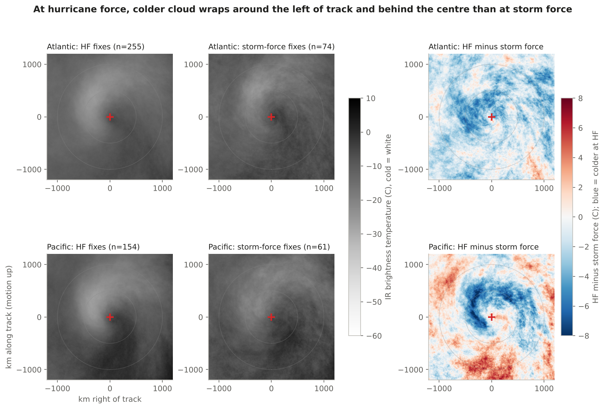

# HF satellite study

*2026-10-17/18 · North Atlantic and North Pacific boxes · truth: hf-low archive category (OPC) · three parts: a two-winter IR pilot (below), the full 2002-2026 IR archive, and air-mass RGB on the pilot winters*

## Full archive, 2002-03 to 2025-26 (IR)

### The answer
Not passed again, for the same reason as the pilot. Over 23 winters the seven IR measures rank HF above storm force better than pressure and latitude alone (held-out ROC area 0.584 to 0.646, +0.062, interval +0.020 to +0.103, 160 weeks), but the chances themselves are barely sharper (Brier -0.0009, interval -0.0039 to +0.0022), and the pre-set rule needs that interval below zero. The gain is a Pacific result: Pacific 0.629 to 0.703, Atlantic 0.561 to 0.581 (interval crosses zero, Brier worse), and little north of 55N (0.556 to 0.582, Brier worse). It is clearest from 2017 on (0.625 to 0.699, Brier -0.0054, interval -0.0102 to -0.0005); that period has more storm-force fixes in the archive (100 of 408 held out, vs 38 of 644 before), which may be most of the reason (inferred, not tested).

### The evidence
| Held-out weeks, seasons 2002-03 to 2023-24 (verdict) | Fixes (HF / storm) | Baseline ROC | With IR ROC | Brier change |
|---|---|---|---|---|
| All | 914 / 138 (319 storms) | 0.584 | 0.646 | -0.0009 [-0.0039, +0.0022] |
| Atlantic | 440 / 55 | 0.561 | 0.581 | +0.0026 (worse) |
| Pacific | 474 / 83 | 0.629 | 0.703 | -0.0040 [-0.0082, +0.0002] |
| Before June 2017 | 606 / 38 | 0.546 | 0.650 | +0.0020 (worse) |
| June 2017 on | 308 / 100 | 0.625 | 0.699 | -0.0054 [-0.0102, -0.0005] |
| South of 55N | 663 / 99 | 0.605 | 0.673 | -0.0025 (interval crosses 0) |
| 55N and north | 251 / 39 | 0.556 | 0.582 | +0.0032 (worse) |

*Baseline: logistic on central pressure and latitude. Gradient boosting on the same inputs: 0.643, no better than the logistic. Tuning weeks (5-fold by storm, 4,659 fixes of 1,352 storms): 0.625 to 0.682. The pilot's held-out weeks (2024-26, already scored once in the pilot) with the model tuned on all years: 0.594 to 0.672, Brier -0.0108 [-0.0218, -0.0017]; that would pass the rule, but those weeks are not the verdict. Pre-2017 has only 38 storm-force fixes, so its larger ROC gain is not the strongest result.*

Imagery: GridSat-B1 IR for every archive fix time, about 6,200 basin-times streamed (~78 GB read, ~12 GB stored and published as truth kind `gridsat`). 7,256 fixes measured, 7,031 with at least 90% of the crop seen; 225 partial views, 188 of them Atlantic HF fixes at high latitude.

## Air-mass RGB, pilot winters 2024-25 and 2025-26

### The answer
Air mass adds nothing over IR here. Adding six air-mass measures (ozone/dry-stratosphere signal from 9.6 minus 10.3 um, upper-level water vapour from 6.2 um, their contrast, and the red-share of the RGB) to IR lowered the held-out ROC area from 0.682 to 0.659 (-0.023, interval -0.102 to +0.047, 11 weeks) and did not sharpen the chances (Brier +0.0038, interval -0.0085 to +0.0209); the pre-set rule needed +0.03 and a Brier interval below zero. In the Pacific, IR + air mass did worse than IR alone (0.655 vs 0.725). This is a statement about these simple measures on 74 fixes, not about what a forecaster reads from the RGB loop.

### The evidence
| Held-out weeks (74 fixes: 52 HF, 22 storm; 23 storms) | ROC area |
|---|---|
| Baseline: pressure and latitude | 0.629 |
| With IR | 0.682 |
| With IR and air mass | 0.659 |
| With air mass, no IR | 0.651 |

By basin: Atlantic IR 0.655, IR + air mass 0.657, air mass alone 0.678 (46 fixes, 15 storms: too few to read as a result); Pacific IR 0.725, IR + air mass 0.655. Tuning weeks (362 fixes): IR + air mass beat IR by only +0.008.

What limits it: GOES ABI only (GOES-East for the Atlantic, GOES-West for the Pacific); the Atlantic HF lows sit far from GOES-East, so 107 Atlantic HF fixes were partial views beyond 80 deg view angle (223 usable). Meteosat would see the eastern Atlantic better and is not in the reader yet. 763 of 764 basin-times were found (npac 2025-01-16 12Z missing), about 25 GB read, 3.4 GB stored and published as truth kind `airmass`.

## Code (full archive and air mass)
`pull.py --seasons 2002-2025`, `features.py --seasons 2002-2025` (writes `features_full.csv` to `RK_DATA/hf-satellite`, 1.2 MB, kept out of git), `run_full.py --final`; `pull_airmass.py`, `features_airmass.py`, `run_airmass.py --final`. Results `results_full.csv`, `scores_full.csv`, `features_airmass.csv`, `results_airmass.csv`, `scores_airmass.csv`.

## Checked by (full archive and air mass)
An independent agent recomputed every number above from `results_full.csv`, `results_airmass.csv` and `features_full.csv` with its own code (10,000 week draws, three seeds; interval ends move by at most 0.003, so no verdict depends on the seed), confirmed that no held-out storm was used in tuning and that the split matches `rk.cases.held_out` on each storm's first archive fix. All matched. It flagged wording to avoid: that IR "helps" in the Atlantic, that pre-2017 is the strongest result, and that the Atlantic air-mass-only number is a finding; this write-up follows that.

---

## Pilot: two winters of IR (2026-10-17)

*2026-10-17 · North Atlantic and North Pacific boxes · seasons 2024-25 and 2025-26 · 616 HF and storm-force fixes of 165 storms; held out 100 fixes, 31 storms, 12 weeks · truth: hf-low archive category (OPC), ASCAT as referee for 2025-26*

### The answer
Not passed, but close: infrared imagery separates the analysts' HF label from storm force a little better than central pressure and latitude, and the pilot does not show that it sees wind the pressure does not. Seven simple IR measures raised the held-out ROC area from 0.59 to 0.67 (+0.08, interval +0.02 to +0.13), but the pre-set rule also needed the Brier gain's interval below zero, and it reaches +0.001 (-0.012, interval -0.027 to +0.001). The gain comes from the Pacific (33 held-out fixes); the Atlantic shows none on the tuning weeks and an uncertain +0.04 held out. Against ASCAT the imagery ranked the peak wind no better than pressure (rank correlation 0.22 vs 0.34, 88 fixes, difference not significant). What differs on average: at hurricane force colder cloud tops wrap around the left of track and behind the centre within about 500 km.

### The evidence
| Method (held-out weeks) | ROC area | Brier | vs baseline |
|---|---|---|---|
| Baseline: logistic on central pressure and latitude | 0.593 | 0.203 | — |
| Pressure, latitude and seven IR measures (logistic) | 0.671 | 0.191 | ROC +0.078 [+0.022, +0.126]; Brier -0.012 [-0.027, +0.001] |
| Same inputs, gradient boosting | 0.587 | 0.218 | worse than the logistic, dropped |

| Basin, held out | Fixes (HF / storm) | Baseline ROC | With IR ROC |
|---|---|---|---|
| Atlantic | 49 / 18 | 0.590 | 0.629 |
| Pacific | 22 / 11 | 0.612 | 0.748 |

*Intervals: 95%, resampling whole ISO weeks (12 held-out weeks; Brier with 10,000 draws, see Checked by). Tuning weeks, 5-fold by storm: baseline 0.634, with IR 0.665 (Atlantic 0.644 vs 0.645, Pacific 0.627 vs 0.693).*

ASCAT referee, winter 2025-26 (Nov-Mar, fixes with at least 300 ASCAT cells within 500 km and 90 min, rain dropped, real 10 m wind): 88 fixes (74 HF, 14 storm) of 50 storms. The archive label is consistent with ASCAT, on only 14 storm-force fixes: median ASCAT peak 62.7 kt at HF fixes vs 55.9 kt at storm-force fixes; 45% vs 7% reach 64 kt (ASCAT reads low at hurricane force, so most HF fixes stay under 64 kt). 70 of the 88 are tuning-week fixes scored out of fold, so this is not a held-out test. Rank correlation of each model's HF chance with the ASCAT peak: baseline 0.34, with IR 0.22 (difference -0.12, interval -0.31 to +0.06, 22 weeks).

Tuning-week medians, HF vs storm-force fixes: coldest 5% of cloud tops within 500 km 236.6 vs 240.4 K; share of cloud tops below -40 C within 500 km 1.8% vs 0.5%; centre (< 150 km) warmer than the 150-500 km ring by 4.9 vs 3.2 K; 12-sector asymmetry 12.0 vs 10.4 K.

### What it does not show
- Wind. The label is the analysts' call, made partly from the same imagery and from ASCAT; on the ASCAT-seen fixes the IR model ranked the peaks no better than pressure. 88 fixes is thin.
- Anything ahead of time. This scores fixes already at storm or hurricane force, not whether a low will reach HF in 12-24 h.
- Storms that never reached HF: every storm-force fix here belongs to a storm that was HF at some point (before or after), so the contrast mixes development and decay stages.
- Water vapour and visible: GridSat's water-vapour channel is empty in these years, so the dry slot is seen only in IR.
- High latitude: geostationary view angles are 63-75 deg at 55-60N; 20 HF and storm-force fixes were dropped for a partial view (crop under 90% seen within 1000 km), 39 HF fixes have no central pressure in the archive and were dropped, and the western Pacific outside the basin box is not in the sample (of 506 HF and 169 storm-force fixes in the boxes, 452 and 164 were scored; the design's 555 and 197 counted fixes outside the basin boxes).

### How it was done
- Truth: hf-low archive (`rk.truth.hf_archive`), HF fixes positive, S fixes negative; ASCAT (`rk.truth.ascat`) as referee only.
- Imagery: GridSat-B1 v02r01 11 um IR (`irwin_cdr`), all geostationary satellites merged, read by byte range with the new `rk/satellite.py` (710 times, about 9 GB streamed, 1.4 GB stored as truth kind `gridsat`, published to the data releases). Crops: 1200 km half-width, 10 km pixels, motion up (heading from the neighbouring archive fixes).
- Features (fixed in `design.md` before the pull): cold-cloud share within 500 and 1000 km, 5th-percentile Tb within 500 km, centre minus ring, warm share right-rear (dry slot), cold share left half (cloud head), sector asymmetry.
- Cases: seasons 2024-25 and 2025-26; a storm is held out when its first fix falls in a held-out week (`rk.cases.held_out`), scored once with `run.py --final`. Composites from tuning weeks only.
- Code: `studies/2026-10-17-hf-satellite/` (`pull.py`, `features.py`, `run.py`, `ascat_check.py`, `figures.py`); results `features.csv`, `results.csv`, `scores.csv`, `ascat.csv`.
- Checked by: an independent agent recomputed every headline number from `results.csv`, `ascat.csv` and `features.csv` without reading this write-up, and refit the logistic model (identical probabilities). All point estimates matched. It found the first draft's 'passes the rule' rested on one bootstrap seed: with 2,000 draws the Brier interval's upper end was -0.00003 at seed 0 and +0.001 to +0.002 at other seeds; with 10,000 draws it is +0.001 at every seed tried, so the rule is not passed. It also corrected the view-angle range and the partial-view count, and flagged that the left-of-track cold band is not clearly stronger in the Pacific in the feature medians; both fixed here.
