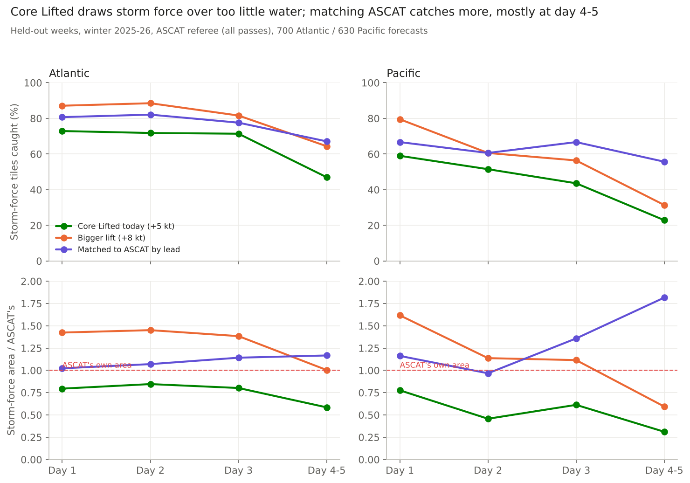

# Bias correction on Core Lifted

*2026-11-05 · Atlantic and Pacific, 00/12Z cycles, +24 to +126 h · winter 2025-26 · held-out: 700 Atlantic / 630 Pacific forecasts in 5 weeks · truth: ASCAT (real 10 m, all passes; Pacific with its 06/18Z passes)*

## The answer
Core Lifted is short on storm force by **area**. On held-out weeks it draws 48 kt over about 0.7x the water where ASCAT sees 48 kt in the Atlantic and 0.5x in the Pacific. The shortfall grows to 0.6x and 0.3x at day 4-5. A bigger correction fixes most of it, and the two basins pick different versions under the pre-set rule:
- **Atlantic:** a plain **+8 kt** in cores (instead of +5) wins. It catches 77% of storm-force tiles instead of 62% (+15 pts, [+14, +18]) and draws storm force over 1.25x ASCAT's area. Matching to ASCAT lead by lead catches 75% at 1.12x but falls 2 points short of the plain +8.
- **Pacific:** **matching to ASCAT by lead** wins. It catches 61% of storm-force tiles instead of 40% (+21 pts, [+15, +28]) at 1.42x ASCAT's area, 9 points better than +8 kt.
- **The price is false storm tiles.** In the Atlantic they go from 78 to 190 with +8 kt (one false tile in four instead of one in seven). In the Pacific they go from 26 to 95 (46% of warned tiles). Gale scores do not move. This is the same trade the retrain study found ("+8 doubles false alarms"). What is new is that today's +5 kt draws too little storm water, so most of those extra false tiles come from drawing about the right amount.
- **A classic average bias correction makes things worse**, as expected: it catches 4-12 points fewer storm tiles, because it pulls the high forecasts down.

Nothing on the page changes until Jason decides. The storm warning line and the HSF storm draft (Core Lifted >= 39 kt) would move too, so they need their own re-score first.

## The evidence
| Held-out, storm force (48 kt) | Atl catch | Atl area / ASCAT | Atl false tiles | Pac catch | Pac area / ASCAT | Pac false tiles |
|---|---|---|---|---|---|---|
| Core Lifted today (+5 kt) | 62% | 0.72 | 78 | 40% | 0.51 | 26 |
| +8 kt in cores | 77% (+15 [+14, +18]) | 1.25 | 190 | 52% (+12 [+8, +17]) | 1.03 | 61 |
| Matched to ASCAT by lead | 75% (+13 [+11, +15]) | 1.12 | 163 | 61% (+21 [+15, +28]) | 1.42 | 95 |
| Average correction (reference) | 58% (-4) | 0.62 | 62 | 29% (-12) | 0.39 | 21 |

*Catch = storm-force 5x5 deg tiles (ASCAT 48+ seen) where the forecast also has 48+ among the seen cells: 741 Atlantic and 181 Pacific events. Intervals are 95% from resampling whole weeks (5 weeks). Gale tile CSI and gale area are unchanged for +8 kt and for matching (the matching may raise winds but never lower them).*

By lead (Atlantic): matching adds little area at day 1-2 (1.02-1.07x, with false tiles at 14-15% against 20-22% for +8 kt) and more at day 4-5, where the shortfall is largest. A constant lift chosen lead by lead within +3..+8 picked +8 at every lead, so it is the same as +8 kt. Without the cap the training weeks picked +8 for day 1-2 and +10 for day 3-5.

Hurricane force (not gated): matching catches 42% of ASCAT 64 kt cells in the Atlantic (today 5%, +8 kt 13%) but draws 2.1x their area. Those cells come from only 17 valid times, so this is a pointer, not a result.

## What it does not show
- Five held-out weeks; one Atlantic week (mid-December) holds 37% of the storm events. The Pacific has 181 storm events and only 3 valid times with ASCAT 64 kt.
- The fitted pieces were trained at 00/12Z-valid leads only. The store has the lower-level fields at 06/18Z steps only for held-out cycles, so in the Pacific the fit saw about a third of its ASCAT cells. The held-out score uses every step and pass.
- The storm and HF warning lines, the HSF draft and the chances were not re-scored.
- One winter. Warm season untested.
- All-water check against the analysis (00/12Z): every version draws far more 48 kt than the analysis has (3.9x today, 6.8x with +8 kt Atlantic), because analyses understate peaks. It confirms where, not how strong.

## How it was done
- Truth: `rk.truth.ascat_target` (real 10 m, intercalibrated, rain dropped), every pass within 90 min.
- Baseline: today's Core Lifted rebuilt from the store (AIFS half weight, +5 kt at core likelihood >= 35%, 34 kt floor at gale core >= 60%). `build.py` matched the retrain study's held-out grids (blend within 0.016 kt, likelihood within 0.0002).
- Methods: `fit_score.py`. The constant and lead-by-lead lift sizes (+3..+8) and frequency matching (`rk.calibrate.quantile_map_fit/apply`, per basin and lead group, on candidate cells, and also split in-core / out-of-core) were fitted on tune weeks with 5-fold whole-week CV. Selection was mechanical (`tune_selection.csv`) and written to `FINAL_CHOICE.json` before the single held-out run (`FINAL_RUN.json`). Plain matching and matching split by core lowered the gale area to 0.73-0.85x on tune weeks and failed the gale line. The "may raise, never lower" version went forward.
- Cases: 604 basin-cycles. 3,389 forecasts built; 2,650 lacked inputs (2,320 of them the 06/18Z steps of tune cycles, see above; 7 Pacific held-out cycles and a few others are missing from the store).
- Checked by: an independent agent recomputed every number in the table and the intervals from `final_case_counts.csv` alone (10,000 week draws, another seed). All matched to the third decimal. It flagged the 5-week sample, the dominant December week and the thin 64 kt sample, all noted above.
