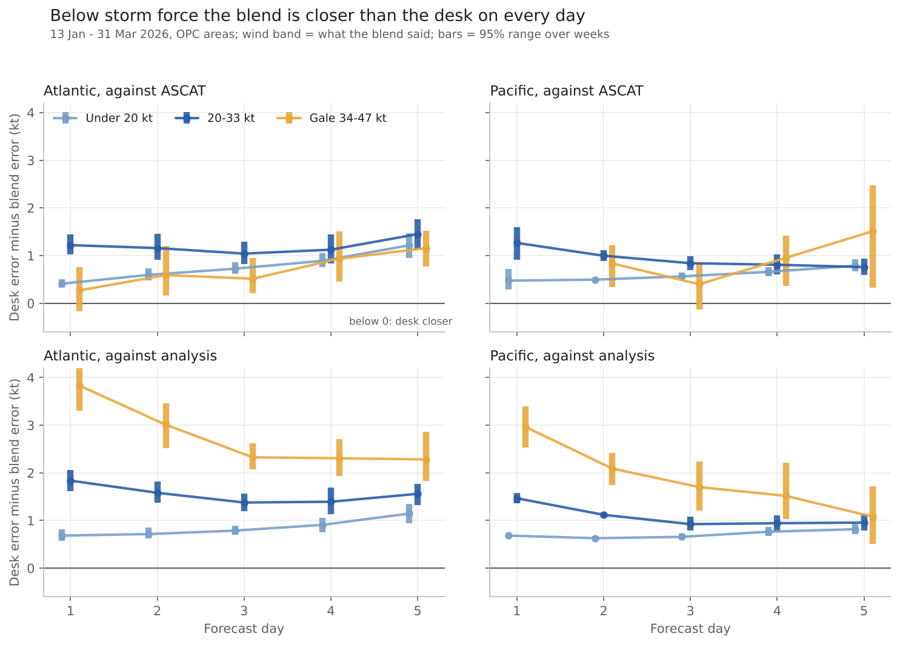
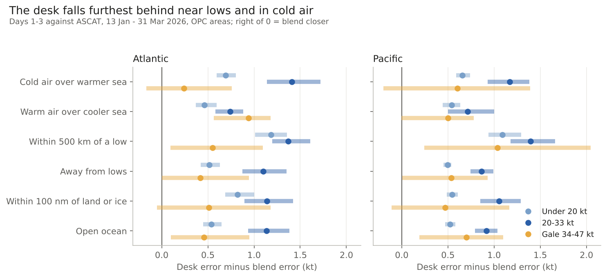
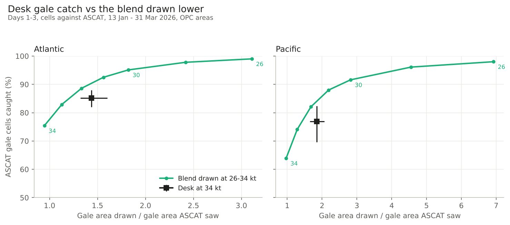

# Desk value beyond storm and HF: findings

*2026-11-05 · both basins, OPC High Seas areas · desk grids 13 Jan - 31 Mar 2026 (155 model cycles, 12 ISO weeks) · truth ASCAT (real 10 m, rain dropped) every synoptic hour, analysis at 00/12Z beside it · page: /research-scores/desk-value/ (awips-tools).*

## The answer
- **Below storm force the blend is closer to ASCAT than the desk's issued grid** in both basins, days 1-5, every band (point estimates) and every situation. Desk error minus blend error, ASCAT, days 1-3: under 20 kt +0.57 [0.48, 0.69] Atl, +0.53 [0.48, 0.58] Pac; 20-33 kt +1.14 [0.94, 1.38] Atl, +0.93 [0.82, 1.05] Pac; gale 34-47 kt +0.46 [0.12, 0.97] Atl, +0.66 [0.19, 1.05] Pac. Atlantic gale day 1 is even (+0.27 [-0.18, 0.76]).
- **The desk reads high in 20-33 kt water**: bias +2.0 kt Atl, +1.6 Pac (blend +0.8, +1.0), days 1-3.
- **Near lows the desk falls furthest behind:** 20-33 kt +1.37 Atl, +1.39 Pac vs +1.10 / +0.86 away; under 20 kt +1.18 / +1.09 vs +0.51 / +0.50. Cold air over warmer sea costs more than warm air over cooler sea at 20-33 kt (+1.41 vs +0.74 Atl, +1.17 vs +0.71 Pac). Coastal water no different from open ocean (ASCAT blind in the first 25-30 km).
- **Gale areas:** at 34 kt the desk catches 85% / 77% of ASCAT gale cells (Atl / Pac, days 1-3) over 1.44x / 1.85x the ASCAT gale area; the blend 75% / 64% at 0.95x / 0.97x. The blend drawn at 32 kt catches 89% at 1.33x / 82% at 1.68x. A blend line at 31-33 kt catches at least as much over no more area than the desk on every day 1-5 in both basins; exceptions only in three thin slices (Atl coastal day 3, Pac coastal and near-low day 1).
- **Against the analysis** the gap is larger (gale band 1-4 kt), as expected from a model truth that smooths peaks; same sign everywhere.

For the desk: start below-storm water from the blend and draw gale lines low on it; desk time pays in storm cores (desk-value study, 16 Oct).

## What it does not show
- One winter half (12 weeks). This winter is unscored until a replacement for RSS ASCAT is in the truth path.
- Core Lifted: its replay covers only two of these weeks (held-out W07, W12); gale catch there 66% vs blend 67%. Not scored with intervals. The live gale-core lift is not in that replay.
- Edits are not scored here; the 16 Oct study found each shift's edits beat an automatic update of the previous grid. It is the starting grid that the blend beats.
- ASCAT share: at 00/12Z ASCAT sees 44% of the Atlantic water scored against the analysis, 1.6% of the Pacific; Pacific ASCAT rests on 06/18Z (5.3 M of 5.7 M cells).
- Situations are stand-ins (stability, distance to a low, distance to land), not analysed fronts.

## How it was done
`score.py` (per cycle parts, resumable; rows in RK_DATA/extra/desk-value-bands/rows.csv.gz), `summarize.py` (week bootstrap, 2000 draws), `figures.py`. Desk snapshot `rk.desk.issue_settled` (13Z / 01Z): the earlier Atlantic file held part of the previous update in 6 of 149 issuances.
