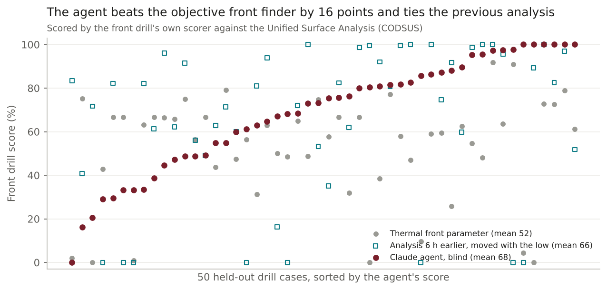
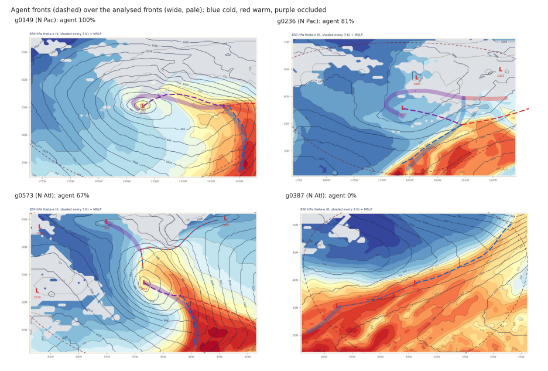

# Agentic first-guess fronts: pilot findings

*2026-11-06 · N Atlantic and N Pacific, 00/06/12/18Z · 13 Aug-5 Nov 2026 · 50 held-out drill cases (30 Atl, 20 Pac) from 14 storms · truth: Unified Surface Analysis (WPC CODSUS), scored by the front drill's own scorer*

## The answer
Claude, playing the front drill blind from the same six panels a forecaster sees, scored **68%** on 50 held-out cases. The textbook objective front finder (thermal front parameter, tuned on the other 444 cases) scored **52%**, so the agent is **16 points better** (90% interval +8 to +28, 36 cases won, 14 lost). It placed the fronts it found a median **51 nm** from the analysed front (TFP 92 nm), got the type right on 88% of them (TFP 79%) and drew 7 extra fronts in all (TFP 122). Its weakness is **missed fronts**: it found 92 of 128 analysed fronts (TFP 107). It roughly **ties the analysis from 6 h earlier moved with the low (66%)**, a first guess the desk already has at analysis time but not at forecast hours.

**Against the win rule set before the run** (at least 10 points over TFP with the interval above zero, under $0.50 an analysis): it passes on points (the low end of the interval, +8, sits under 10). Cost is unmeasured in dollars because the pilot ran inside this session, with no API key. It used about 25,000 tokens and 11 tool calls a case, roughly $0.10-0.50 at Opus API prices.

## The evidence
| Method | Score | Fronts found | Type right (of found) | Median distance | Extra fronts | Cases scoring 0 |
|---|---|---|---|---|---|---|
| Thermal front parameter (850 theta-e, tuned on 160 of the 444 tune cases) | 52.4 | 107 / 128 | 84 (79%) | 92 nm | 122 | 3 |
| Analysis 6 h earlier, moved with the low (reference) | 65.6 | 93 / 128 | 85 (91%) | 74 nm | 20 | 8 |
| **Claude agent, blind** | **68.3** | 92 / 128 | 81 (88%) | 51 nm | 7 | 1 |
| Agent minus TFP | +15.9 [+7.6, +27.8] | | | | | 36 won, 14 lost |
| Agent minus 6 h analysis | +2.8 [-4.7, +11.9] | | | | | 20 won, 28 lost, 2 tied |

By basin, the agent scored 62.5 (Atlantic) and 77.1 (Pacific); TFP 53.0 and 51.6; the 6 h analysis 64.0 and 67.9. *Intervals: 90%, resampling whole storms (14 storms; cases of one low within 48 h and 1000 nm go together); resampling cases gives +8.3 to +23.6.*

The agent's misses were 16 of 61 cold fronts, 13 of 36 warm fronts and 7 of 31 occlusions, with a median length of 360 nm. Most of these were the second front of a system it judged too weak to draw (its own notes: "short warm front rests on thin evidence", "no wind shift in uniform flow"). TFP misses occlusions (12 of 31) because it cannot find them, and it typed 15 cold fronts as occluded.

## What it does not show
- **Fourteen storms.** The 50 cases come from 14 storms in the held-out weeks, so the sample is closer to 14 than to 50. This is "worth scaling", not "operational".
- **Not a scripted run.** The agents were Claude sessions told not to open anything but their case folders, and they report that they did not (two listed the folder of other cases' answers by wildcard and did not open them). A scripted API run would enforce that and is needed for repeat runs or a four-times-a-day product.
- **Analysis hour only.** At a forecast hour there is no previous analysis, which is the setting where the agent should add the most; this pilot did not test it.
- **Coarse fields.** The panels come from the drill's 0.5 deg boxes; analysts use finer maps.
- **Shapiro-Keyser systems** are coded as occluded or warm, so some type "errors" are partly truth noise (for example g0473, a bent-back warm front).

## How it was done
- Truth: CODSUS coded fronts, the system's cold/warm/occluded fronts only, scored by `scoreCase` from the front drill page (`../2026-11-06-front-drill/page/app.js`, loaded unchanged under node by `score.js`). Lows and stationary fronts are given, as for a trainee.
- Agent: ten Claude agents, five cases each. Each case folder held only the six panels (`panels.py`), the given lows and stationary fronts (`case.txt`), two worked examples from tune weeks of other storms with their analysed fronts (`blind.py`), and a cross-section / gradient / trough tool on the case's fields (`tools.py`). Instructions: `agent_brief.md`. Answers: `agent_answers.json`, with one line of reasoning per front. Tokens per batch: `agent_usage.csv`.
- TFP baseline: `rk/frontfind.py` (new, tested in `tests/test_frontfind.py`) through `baseline_tfp.py`. Two grid searches over 160 tune cases (`tfp_tune_round1.csv`, `tfp_tune.csv`); best: smoothing 1 cell, gradient at least 3 K per 100 km, pieces at least 250 nm, shifted 1 cell toward the warm air, within 500 nm of the low, no occlusion rule (the occlusion rule lowered the score). 50.1 on tune cases, 52.4 on the test cases.
- Persistence: `baseline_persist.py` (needs `rk.fronts` from the front drill, PR #75).
- Cases: `deck.test_ids()`, a seeded draw from the 78 held-out-week cases (`rk.cases.held_out`).
- Checked by: a second agent re-scored all three methods from the saved answers without reading this write-up. All 150 per-case scores matched, as did the means (68.31, 52.44, 65.55) and the intervals. The scorer gave 100 when fed the analysed fronts and 0 for an empty drawing on 5 cases. All test cases are from held-out weeks, no worked example is within 48 h of its test case, and the blind folders hold none of the test case's own analysed front points. Only given stationary-front ends and low positions overlap, and the trainee sees those anyway.

## Next, if Jason wants it
1. **Scripted API run** of all 522 cases (needs an `ANTHROPIC_API_KEY`). It gives an exact cost and a run that can be repeated. Estimated $50-150.
2. **Forecast-hour test**: first-guess fronts on GFS +24/+48 h, scored against the analysis valid then. That is the use the desk can't get from the previous analysis.
3. **Prompt fix for misses**: tell the agent that a missed front costs more than an extra one, and to draw the second front when the examples show one. Re-test on the same 50 cases.
