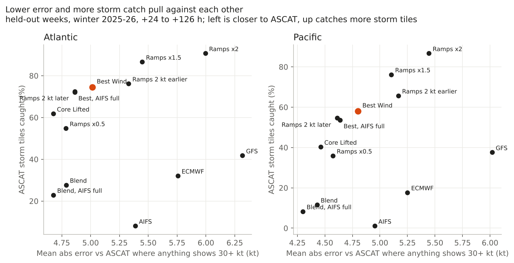
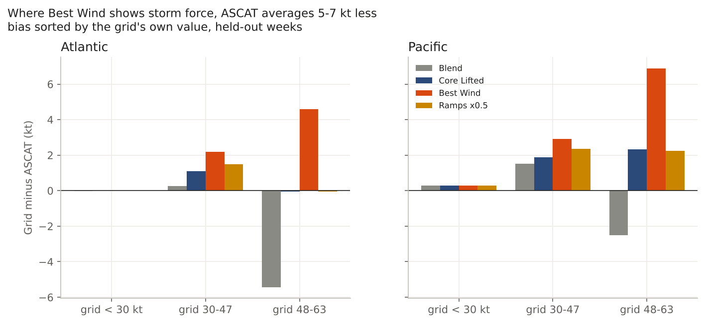

# The page wind grid as a most-likely wind

*2026-11-07 · both basins, 00/12Z cycles, +24 to +126 h (06/18Z-valid steps included) · winter 2025-26 · held-out: 70 cycles x 2 basins in 5 ISO weeks, 1,330 cases (Atlantic 5.2 M, Pacific 4.0 M ASCAT cells) · truth: RSS ASCAT real 10 m*

## The answer
If the grid's only job were the smallest error against ASCAT, the plain blend would win, with AIFS at full weight (decision-cell error 4.7 Atl / 4.3 Pac kt, against 5.0 / 4.8 for Best Wind). But it catches only 23% / 8% of ASCAT storm tiles, because no smooth field reaches the cores. Every lift trades error for catch along one curve, and none of them places cores better. Equal-area storm catch is 0.60-0.62 Atl and 0.40-0.42 Pac for the blend, Core Lifted and every Best Wind variant alike, so a lift moves the level, not the position.

Best Wind sits where the desk wants it, about 0.2-0.4 kt more error on the 30+ kt cells for +47 / +46 points of storm catch and +59 / +40 points of HF catch over the blend. No tested change passed the rule set before the run: lower error in both basins without losing more than 2 points of storm catch or any HF catch. **Keep Best Wind as it is.**

The cost is honest to state. Where Best Wind shows 48-63 kt, ASCAT averages 4.6 kt (Atl) / 6.9 kt (Pac) less, and 2-3 kt less where it shows 30-47. As a most-likely field it runs hot inside its own cores; it is a "where the storm-force wind is" field. Ramps at half size would make the Atlantic storm band read true (bias 0.0) at -0.23 kt error, but storm catch falls 74 -> 55% (Atl) and 58 -> 36% (Pac).

## The evidence (held-out)
| Grid | All water MAE / bias (Atl, Pac) | 30+ kt cells MAE (Atl, Pac) | Bias where grid shows 48-63 (Atl, Pac) | Storm tiles caught (Atl, Pac) | HF tiles caught (Atl, Pac) |
|---|---|---|---|---|---|
| GFS | 4.1 / -0.7, 3.8 / -0.3 | 6.3, 6.0 | +2.5, +8.8 | 42%, 38% | 17%, 7% |
| ECMWF | 3.8 / -1.1, 3.4 / -0.7 | 5.8, 5.2 | -2.3, +10.4 | 32%, 18% | 10%, 7% |
| AIFS | 3.4 / -1.6, 3.2 / -1.3 | 5.4, 5.0 | (few cells) | 8%, 1% | 0, 0 |
| Blend (page, AIFS half) | 3.11 / 0.0, 2.82 / +0.4 | 4.79, 4.43 | -5.4, -2.5 | 28%, 12% | 2%, 0 |
| Blend, AIFS full weight | 3.02 / -0.1, 2.74 / +0.3 | 4.68, 4.30 | -6.2, -5.0 | 23%, 8% | 0, 0 |
| Core Lifted | 3.08 / +0.2, 2.83 / +0.4 | 4.68, 4.46 | -0.1, +2.3 | 62%, 40% | 16%, 7% |
| **Best Wind (live)** | 3.16 / +0.4, 2.88 / +0.5 | 5.02, 4.80 | +4.6, +6.9 | **74%, 58%** | **61%, 40%** |
| Best Wind, AIFS full | 3.06 / +0.3, 2.79 / +0.4 | 4.86, 4.64 | +4.0, +6.1 | 72%, 54% | 55%, 27% |
| Best Wind, ramps x0.5 | 3.11 / +0.2, 2.85 / +0.5 | 4.79, 4.57 | 0.0, +2.3 | 55%, 36% | 22%, 7% |
| Best Wind, ramps 2 kt later | 3.13, 2.85 | 4.87, 4.61 | +3.5, +5.9 | 72%, 55% | 50%, 33% |
| Best Wind, ramps x1.5 | 3.26, 2.92 | 5.45, 5.10 | +8.1, +10.5 | 87%, 76% | 80%, 53% |

"30+ kt cells" = cells where ASCAT or any candidate is 30 kt or more, the same cells for every grid. Storm tiles: 741 Atl / 181 Pac; HF tiles 122 Atl / **15 Pac** (Pacific HF is thin).

Against Best Wind, whole-week intervals (95%):
- AIFS at full weight: 30+ kt error -0.15 [-0.18, -0.13] Atl / -0.16 [-0.19, -0.14] Pac, but storm catch -2 [-4, -1] / -4 [-8, -1] points and HF -7 [-16, -2] / -13 points. Fails the rule.
- Ramps 2 kt later: -0.15 / -0.19 kt, storm -2 / -3 points, HF -11 / -7. Fails the rule.
- Ramps x0.5: -0.23 / -0.23 kt, storm -20 / -22 points. Fails the rule.
Tune weeks (2,060 cases) gave the same ordering and no passing variant (PICK.json).

## The three side questions
- **Ramp size.** Right for its job. At half size the storm band reads true but catch drops ~20 points; at 1.5x catch rises 12-18 points but storm area is 1.9x / 2.9x ASCAT's and error rises 0.3-0.4 kt. Today's size is where the catch gain per added knot of error flattens (fig 1).
- **AIFS weight.** Full weight lowers error everywhere by about 0.1 kt (blend and Best Wind alike, intervals exclude zero), because AIFS is the smoothest, lowest-error single model below gale (it is also the lowest-catch model). It costs 2-4 points of storm catch and 7-13 points of HF catch under Best Wind. Leave it at half, as the 10-16 study found.
- **Pacific blend hot below gale.** Partly. Below 30 kt it is +0.3 kt (Atlantic 0.0), which is negligible. Where the Pacific blend shows 30-47 kt, ASCAT averages 1.5 kt less (Atlantic +0.3 on held-out; tune weeks +0.7 vs -0.2). The spread term causes most of it: without it the Pacific gale band reads 0.0, but storm catch falls. That is small enough to read, not fix; a Pacific-only spread change would need its own test.

## What it does not show
- Held-out is 5 ISO weeks of one winter; the intervals resample those weeks, so they are tighter than another winter would allow.
- Sorting by the ASCAT band (as first asked) makes every grid look ~11-13 kt low at 48-63 and 18-30 kt low at 64+, and high below 30. That is regression to the mean, not a bias to correct (`bands_heldout.csv`, cut "truth"). The grid-band cut above is the fair test.
- ASCAT itself runs a few kt low in the strongest cores (storm-force truth study), so part of Best Wind's +4.6/+6.9 is the referee.
- Not tested: the GFE Make_BestWind (deterministic #95 blend) grid, warning lines, HSF. Tune-week 06/18Z-valid steps mostly lacked the core chances and were skipped (2,495 cases); held-out kept all but 70.

## How it was done
- Truth: `rk.truth.ascat_target` (intercalibrated, rain dropped, +-90 min), open water, all ASCAT-seen cells.
- Grids rebuilt from the store per case (`build_cases.py`): page blend pieces (support-weighted base at AIFS weight 0 / 0.5 / 1, spread term), live core chances, GEFS 48 kt share; page r10 reproduced to 0.05 kt. Best Wind exactly as awips-tools `storm.best_wind` + gale-core floor.
- Scores: `rk.score.band_error` (new, tested); tiles as strong-core-lift; equal-area catch from 1 kt histograms (`score_cells.py`, `summarize.py`). Rule and pick on tune weeks (`PICK.json`) before held-out was scored once.
- Code: `studies/2026-11-07-most-likely-wind/`; rows in `RK_DATA/extra/most-likely-wind/`.
- Checked by: an independent agent recomputed every held-out number in the table above from the raw row files (err/tiles CSVs) without reading this write-up; every value matched to 0.01 kt / 0.01 catch. It flagged the 15-tile Pacific HF sample and the small blend 48-63 band samples (Pac 560 cells), both noted.

## Follow-up: the right gale area (Jason 16:48-16:50Z)
"the problem of drawing the grid in the wrong spot... cant really be avoided. so i can live with that. so what solution draws the right amount of area and magnitude" / "how would we fix it".

Whole winter, grid area over ASCAT area at 34 / 48 / 64 kt: Best Wind 1.26 / 0.94 / 0.87 (Atl), 1.30 / 0.87 / 0.41 (Pac; HF on 255 ASCAT cells). Storm force is right; gale is 26-30% too wide, all from the gale-core floor (blend alone 0.85 / 0.81).

Floor variants on Best Wind (`gale_floor.py`; storm and HF untouched by construction). Held-out:

| Gale floor | Gale area (Atl, Pac) | Gale cells caught | Gale tiles caught | False gale tiles | 30+ kt cell error vs live |
|---|---|---|---|---|---|
| live: chance >= 60% | 1.27, 1.38 | 78%, 69% | 81%, 73% | 835, 504 | — |
| chance >= 70% | 1.14, 1.24 | 74%, 66% | 79%, 72% | 733, 473 | -0.02 [-0.03, 0.00], -0.03 [-0.04, -0.02] |
| **chance >= 80%** | **1.05, 1.13** | 71%, 63% | 77%, 71% | 670, 448 | -0.02 [-0.04, +0.01], -0.04 [-0.05, -0.03] |
| chance >= 90% | 0.98, 1.06 | 67%, 59% | 75%, 70% | 638, 437 | |
| off | 0.95, 1.04 | 65%, 58% | 75%, 70% | 632, 436 | |

The error barely moves either way (tune weeks: +0.006 / +0.015 kt at 80%; held-out -0.02 / -0.04), so the pre-set rule ("no added error", tune weeks) kept the live floor by thousandths of a knot. That is noise, not a reason. **If the grid should draw ASCAT's gale area, the fix is the floor at 80% chance:** gale area 1.03 / 0.95 tune and 1.05 / 1.13 held-out, at 7 / 6 points fewer gale cells caught, 20 / 11% fewer false gale tiles, no change at storm or HF. The gale warning line (strongest model >= 30) carries the gale "possible". A partial floor (raise toward 34 by the chance) cuts error most but never reaches 34, so it draws no more gale than the plain grid.
