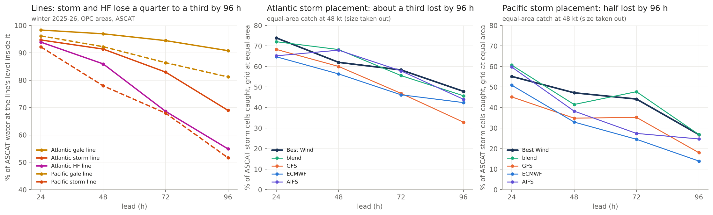
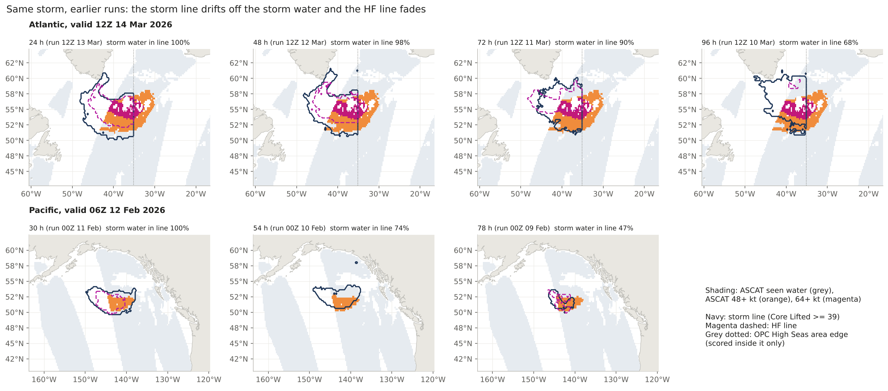

# How Best Wind and the warning lines hold up at 72 and 96 h

*2026-11-15 · Atlantic and Pacific, valid 00/12Z (+ Pacific 06/18Z) · winter 2025-26 (1 Nov - 31 Mar) · 302 runs per basin, 5,372 run-leads, 23 weeks · truth: RSS ASCAT real 10 m wind, seen open water, OPC High Seas areas for the lines*

## The answer
- **Gale is solid out to 96 h.** The gale line still covers 91% of the Atlantic gale water (98% at 24 h) and 81% of the Pacific's (96%). It grows a little as it goes (Atlantic 2.0x to 2.3x ASCAT's area), and more of it is empty (19% to 35%).
- **Storm holds through 48 h, then slides off the storm.** The Atlantic storm line covers 95% / 91% / 83% / 69% of ASCAT storm water at 24 / 48 / 72 / 96 h, and the Pacific's covers 92% / 78% / 68% / 52%. The line doesn't widen to make up for it: Atlantic area is 2.1x at 24 h and 1.9x at 96 h. The models know the storm is coming, but not where its core will be.
- **HF is a 48 h product.** The Atlantic HF line covers 94% / 86% / 69% / 55% of ASCAT HF water. Best Wind's HF area is right at 24-48 h (1.2x) but falls to 0.45x at 96 h, and its HF tile catch goes 82% to 23%. The Pacific had one ASCAT HF event all winter, so it can't be scored.
- **The grid shrinks as well as drifts.** Best Wind's storm area goes from 1.06x to 0.85x (Atlantic) and 1.16x to 0.74x (Pacific) by 96 h, because the blend smooths out as the models disagree on position, and the ramps sit on top of the blend.
- **No single model holds up better than Best Wind.** With size taken out (equal-area catch at 48 kt), Atlantic storm placement is Best Wind 74% to 48% from 24 to 96 h, blend 72% to 46%, ECMWF 65% to 42%, GFS 68% to 33%. GFS loses placement fastest at day 4. AIFS places storms about as well as the blend (44% at 96 h) even though it is too weak to draw them.

## The evidence
Warning lines (share of ASCAT water at the line's level inside the line / line area as a multiple of ASCAT's / share of the line with nothing nearby):

| Line | 24 h | 48 h | 72 h | 96 h | 96 h vs 24 h |
|---|---|---|---|---|---|
| Atlantic gale | 98% / 2.0x / 19% | 97% / 2.0x / 22% | 94% / 2.1x / 28% | 91% / 2.3x / 35% | -7.5 pts [-8.8, -6.4] |
| Atlantic storm | 95% / 2.1x / 19% | 91% / 2.3x / 25% | 83% / 2.2x / 30% | 69% / 1.9x / 34% | -26 pts [-34, -20] |
| Atlantic HF (54 events) | 94% / 9.4x / 62% | 86% / 8.6x / 62% | 69% / 8.7x / 70% | 55% / 7.4x / 71% | -39 pts [-69, -22] |
| Pacific gale | 96% / 3.2x / 40% | 92% / 3.4x / 45% | 86% / 3.7x / 52% | 81% / 4.0x / 59% | -15 pts [-19, -12] |
| Pacific storm (19-30 events) | 92% / 4.6x / 49% | 78% / 4.3x / 56% | 68% / 3.4x / 60% | 52% / 4.0x / 72% | -41 pts [-72, -20] |

Best Wind grid (grid area as a multiple of ASCAT's at 48 / 64 kt; ASCAT storm cells inside the grid's 48 kt; storm and HF tiles caught):

| Best Wind | 24 h | 48 h | 72 h | 96 h | 120 h |
|---|---|---|---|---|---|
| Atlantic storm area / HF area | 1.06 / 1.21 | 1.12 / 1.21 | 1.05 / 0.85 | 0.85 / 0.45 | 0.64 / 0.69 |
| Atlantic storm cells caught | 74% | 70% | 58% | 42% | 30% |
| Atlantic storm / HF tiles caught | 83% / 82% | 79% / 73% | 70% / 51% | 57% / 23% | 44% / 21% |
| Pacific storm area | 1.16 | 1.03 | 1.04 | 0.74 | 0.17* |
| Pacific storm cells caught | 64% | 47% | 44% | 21% | 5%* |
| Pacific storm tiles caught | 73% | 62% | 58% | 37% | 20%* |

*Brackets: 90% intervals, resampling whole weeks. \*Pacific 120 h is 00Z valid only (few ASCAT passes). Grid rows use the 360 Atlantic / 318 Pacific run-leads that have the core chances (all 00/12Z runs at 00/12Z valid, about 40% of 06/18Z valid).*

## Worked cases
- **Atlantic, valid 12Z 14 Mar 2026.** This was a hurricane-force storm southeast of Cape Farewell. The storm line held 100% / 98% of the storm water at 24 / 48 h. At 72 h it held 90%, and at 96 h 68%, with the line drawn 3-5 degrees too far northwest. The HF line was on the core at 24-48 h, drifted west at 72 h, and was almost gone at 96 h.
- **Pacific, valid 06Z 12 Feb 2026.** This was a storm in the Gulf of Alaska. The storm line covered all of it at 30 h, 74% at 54 h, and 47% at 78 h, where it was drawn smaller and on the west side of the storm.

## What it does not show
- Pacific HF: one ASCAT HF event in the OPC area all winter. Pacific storm has 19-30 events per lead, so its intervals are wide.
- One winter only. These are the winter-build products (live rules as of 7 Nov 2026) rebuilt from the store, not the live page's own archive.
- Area ratios count ASCAT-seen water only. Big storms are partly unseen at any one valid time.
- The desk grids and HSF are not scored here.

## How it was done
- Truth: RSS ASCAT real 10 m (`rk.truth.ascat_target`: intercalibrated, rain dropped, passes within 90 min of valid). Lines are scored with `rk.score.warning_events` at their own level (gale 34, storm 48, HF 64; events = connected ASCAT areas, caught within 60 nm), inside the OPC High Seas areas.
- Products, as live: Best Wind (blend + ramps 36-40 / 44-48 of the stronger of GFS/ECMWF + HF core where GEFS P48 nearby >= 30%, gale-core floor at 80%). Lines: gale = strongest model >= 30 (pieces under 32 cells dropped), storm = Core Lifted >= 39, HF = strongest >= 44 and >= 1% of GEFS+ENS+AIFS ENS members at 64 kt within about a degree.
- Leads 24/48/72/96/120 h, with the 06/18Z-valid steps 30/54/78/102 pooled into the lead below them (that is where the Pacific's ASCAT is). Nothing tuned, all weeks used.
- Code: `studies/2026-11-15-lead-decay/` (`score.py`, `summarize.py`, `figure.py`, `cases_fig.py`). Cases come from the most-likely-wind build (`studies/2026-11-07-most-likely-wind/build_cases.py`) rerun at these steps, from the shared store, with no new pulls.
- Checked by: a second agent recomputed every line and Best Wind number in the tables, plus equal-area storm catch for Best Wind, blend, GFS and ECMWF, working only from the per-case files (`line_cases.csv.gz`, `grid_cases.csv.gz`, `hist.npz`) without reading the summary code or this write-up. Every value matched to 2 decimals, and its hist 48 kt counts equal the grid file's exactly. It flagged the thin Pacific HF/64 kt and 120 h samples, which are marked above.
