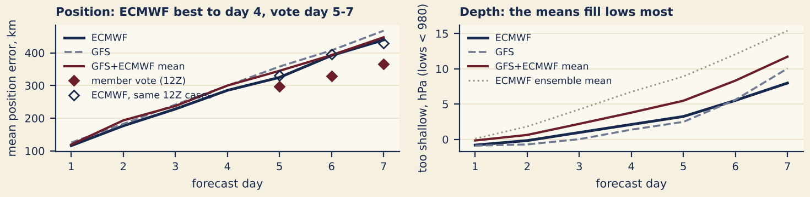
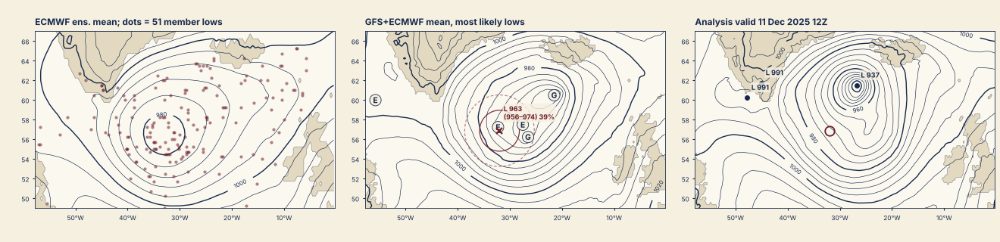
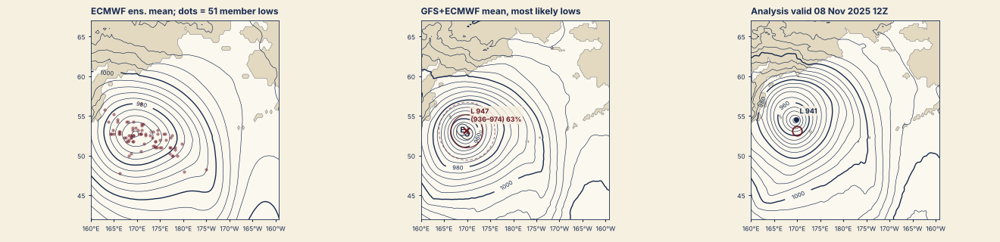
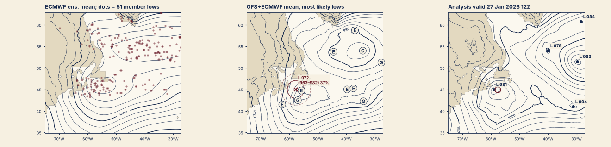
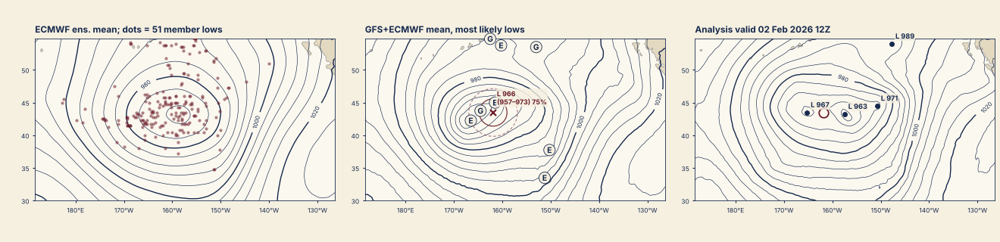

# Best MSLP forecast to day 7: where to lean, how to show it

*Briefing for Jason, OPC marine desk, 16 November 2026. Winter 2025-26 (1 November to 31 March), North Atlantic and North Pacific, 00Z and 12Z runs. Truth: the mean of the GFS and IFS analyses. “ECMWF” is the IFS deterministic.*

## Bottom line

Lean on ECMWF, with GFS close, to place lows out to day 4. Draw the isobars from the GFS+ECMWF mean, but take each low’s depth from the runs’ own depths, not from the blended field, which fills strong lows. From day 5 the member vote places lows best, but it needs members that are not on AWIPS.

Converging the field on the best low adds almost nothing, and the blend left after dropping the odd model loses to ECMWF. Both worries are real: even ECMWF is 439 km out on the average low by day 7 (a missed low counts as 1000 km), and every source is shallow on strong lows at day 7 (ECMWF 8.0, GFS 10.0 hPa), so expect the real low to be several hPa deeper than any label.

## What works on AWIPS today

- Isobars from the GFS+ECMWF mean.
- Lows placed with ECMWF, GFS close behind.
- The day 5-7 member vote, with its chances, circles and depth range, needs ECMWF ENS and AIFS ENS members. Those are not on AWIPS.
- A GEFS-only vote was not tested. CMC and UKMET were not tested either: they are not in the store.

## Five key points

1. **Days 1-4: lean on ECMWF, with GFS close behind. ECMWF’s mean error is 285 km at day 4 (GFS 300 km).** Days 1-2 are a tie: against the GFS analysis GFS wins by 22 and 11 km, against the ECMWF analysis ECMWF wins by about 50 km. ECMWF is clearly ahead from day 3. It draws more lows (0.5 to 2.5 false per map, against 0.2 to 1.75 for the GFS+ECMWF mean), and a missed low counts as 1000 km. The GFS+ECMWF mean ties ECMWF at day 1, 6 and 7 and is 9 to 20 km worse at days 2 to 5.
2. **The GFS+ECMWF mean gives the best isobars of the AWIPS runs but fills strong lows, about 4 hPa more than ECMWF by day 7.** It is closer to the analysis than GFS or ECMWF at every lead. AIFS alone is closer than the mean from day 2 on (by 0.04 to 0.25 hPa) but worse at day 1 (0.64 against 0.62), and it is not on AWIPS. A depth fix in the field recovers only 0.2 to 0.8 hPa on the two-run mean (about 2 hPa on blends of 3 or more runs), so label instead. Every source is shallow on strong lows at day 7 (ECMWF +8.0, GFS +10.0, vote +7.6 hPa; a missed low is charged the field value at its centre). No depth-threshold chance (990, 980, 970 hPa) is ready to show: the checks failed.
3. **Converging on the best low and fitting the field around it is not worth it: it moves the mean low position by under 5 km.** Pulling each run’s low to the consensus spot before averaging leaves the lows within 5 km of the plain mean. Ensemble means in the blend lower the field error but cost about 60 km in position, because they wash out the weaker lows. Keep the simple mean.
4. **Dropping the model that drifts from the consensus is usually the right call: the dropped model was the closest to the analysis only 7-13% of the time.** But the blend left behind still contains the ensemble means and loses to ECMWF by 69 to 115 km. Tested on GFS, ECMWF, AIFS and AI-GFS only. Weighting by recent skill is no help either (Recent MSLP skill study, 13 Oct 2026).
5. **Days 5-7: the member vote likely places the lows best, 34 to 67 km closer than ECMWF, but this is likely, not proven.** It was chosen on overlapping weeks, so this is not a blind test (Day 5-7 pressure study, 16 Oct 2026, repeated on this winter). It draws about 0.18 more false lows per map than ECMWF, and Pacific day 5 is a tie. It uses GEFS, ECMWF ENS and AIFS ENS members, with the GFS, ECMWF and AIFS runs as light voters.

Sample: one winter, 23 weeks, both basins, 00Z and 12Z runs; the member vote is 12Z only.

Worked cases (page 2): of the 7 with a member vote, the analysed low was outside the 50% circle in 2; the deepest storm of the winter (11 Dec, 937 hPa) was missed by the vote and by ECMWF.

## What probability says at day 5-7

| Day 5-7 member vote, winter, 12Z | Day 5 | Day 6 | Day 7 |
|---|---|---|---|
| Chance the low exists: better than always forecasting the average rate by (0 = no better) | 0.21 | 0.17 | 0.10 |
| 10-90% depth range holds the analysed depth (aim 80%) | 80% | 84% | 82% |
| 50% position circle: radius (share that verified) | 391 km (48%) | 440 km (49%) | 480 km (53%) |
| 80% position circle: radius (share that verified) | 751 km (81%) | 764 km (81%) | 777 km (82%) |
| Alternative low (at least 20% of members, over 300 km away): shown / right | 11% / 37% | 9% / 34% | 7% / 28% |

- Chance it exists is reliable at day 5; at day 6-7 the top bins miss; in winter it runs 4 to 6 points low. The analysis is 1.0 to 1.7 hPa deeper than the vote median; ranges are wide (15 to 20 hPa).
- 50% circle: 231 to 327 km for lows most members carry, 634 to 642 km for lows few carry. A far-away alternative is right 1 time in 3 (chance 7-9%).

## How to show it (proposal)

- Plain isobars every 4 hPa from the GFS+ECMWF mean, with G and E marks where GFS and ECMWF put their own lows.
- Days 1-4: label each low with depth only, from the runs’ own depths. No range or chance was verified there.
- Days 5-7: label depth, 10-90% range and chance the low exists, “L 947 (936-974) 63%”, and draw a position circle sized by member support (solid 50%, dashed 80%). This needs members not on AWIPS. Leaving off lows under 30% chance is a guess to test.
- An alternative low only when at least 20% of members put one more than 300 km away (open diamond with its share).
- Depth-threshold chances (990, 980, 970 hPa) are left off because they failed their checks.
- A proposal only: mock-up screenshots first, nothing live until you agree (GFE: a normal MSLP grid, chances in a table).

## Three worked cases (day 5, 12Z run)

Left: ECMWF ensemble mean with each member's low (dots). Middle: the proposed display on the GFS+ECMWF mean. Right: the analysis, with the vote lows as open rings. Three maps show how the display reads; they settle nothing.

**North Atlantic, deepest analysed low of December. Day 5 from 06 Dec 2025 12Z, valid 11 Dec 2025 12Z.**

Analysis 937 hPa; lowest pressure near it: GFS 939, ECMWF 963, GFS+ECMWF mean 960, ECMWF ensemble mean 979. Vote: L 963 (956-974), 39% chance, 592 km off; analysis outside the 50% circle, outside the range. The deepest storm of the winter. The vote missed it (592 km off, 26 hPa shallow) and so did ECMWF (963 hPa, 447 km off); only GFS had it.

**North Pacific, deepest analysed low of November. Day 5 from 03 Nov 2025 12Z, valid 08 Nov 2025 12Z.**

Analysis 941 hPa; lowest pressure near it: GFS 935, ECMWF 945, GFS+ECMWF mean 944, ECMWF ensemble mean 964. Vote: L 947 (936-974), 63% chance, 160 km off; analysis inside the 50% circle, inside the range. Good: vote low, circle and range all caught it; the ensemble mean filled it by about 20 hPa.

**North Atlantic, largest GFS-ECMWF split at day 5. Day 5 from 22 Jan 2026 12Z, valid 27 Jan 2026 12Z.**

Analysis 981 hPa; lowest pressure near it: GFS 980, ECMWF 977, GFS+ECMWF mean 983, ECMWF ensemble mean 981. Vote: L 972 (963-982), 37% chance, 99 km off; analysis inside the 50% circle, inside the range. GFS and ECMWF put their lows 1430 km apart (GFS 42.5N 57W, ECMWF 55.2N 60W); the vote settled near the analysed low but was 9 hPa too deep.

## What this sample cannot settle

- Position gaps under about 25 km cannot be told apart, and day 1-2 gaps sit inside the 130 km average low-position difference between the GFS and IFS analyses.
- Chance of a low deeper than 970 hPa shows no skill, and below 960 hPa there are too few lows to verify.
- Days 1-4 and 00Z have no stored members, so no probability there until a member pull (needs your go). AI-GFS has too few cases (158 runs) to choose.
- Pressure only, against the two analyses (no ERA5); wind is not tested here (Pressure to wind, 13 Oct 2026, found no gain).

## Appendix: worked cases

Chosen by the study's rule before scoring: the deepest analysed low per month (November to March) per basin, and the largest GFS-ECMWF split at day 5 per basin. Pressures are the lowest value within 500 km of the analysed low (hPa).

| Case | Valid | Analysis | GFS | ECMWF | GFS+ECMWF mean | ECMWF ens mean | Vote low (range) chance, km off | Map |
|---|---|---|---|---|---|---|---|---|
| N Atlantic deep | 2026-01-26 00Z | 940 | 946 | 957 | 962 | 966 | no members (00Z) | [png](figs/natl-deep-2026-01-26.png) |
| N Atlantic deep | 2026-02-21 00Z | 960 | 967 | 965 | 975 | 981 | no members (00Z) | [png](figs/natl-deep-2026-02-21.png) |
| N Atlantic deep | 2026-03-06 12Z | 949 | 962 | 956 | 970 | 974 | L 966 (952-982) 55%, 229 km | [png](figs/natl-deep-2026-03-06.png) |
| N Atlantic deep | 2025-12-11 12Z | 937 | 939 | 963 | 960 | 979 | L 963 (956-974) 39%, 592 km | [png](figs/natl-deep-2025-12-11.png) |
| N Pacific deep | 2026-01-05 00Z | 950 | 941 | 952 | 948 | 963 | no members (00Z) | [png](figs/npac-deep-2026-01-05.png) |
| N Pacific deep | 2026-02-10 12Z | 944 | 937 | 946 | 949 | 958 | L 945 (936-955) 64%, 149 km | [png](figs/npac-deep-2026-02-10.png) |
| N Pacific deep | 2026-03-07 00Z | 973 | 976 | 971 | 982 | 983 | no members (00Z) | [png](figs/npac-deep-2026-03-07.png) |
| N Pacific deep | 2025-11-08 12Z | 941 | 935 | 945 | 944 | 964 | L 947 (936-974) 63%, 160 km | [png](figs/npac-deep-2025-11-08.png) |
| N Pacific deep | 2025-12-02 12Z | 963 | 974 | 957 | 970 | 975 | L 969 (957-982) 40%, 193 km | [png](figs/npac-deep-2025-12-02.png) |
| N Atlantic split | 2026-01-27 12Z | 981 | 980 | 977 | 983 | 981 | L 972 (963-982) 37%, 99 km | [png](figs/natl-split-2026-01-27.png) |
| N Pacific split | 2026-02-02 12Z | 963 | 956 | 966 | 962 | 971 | L 966 (957-973) 75%, 356 km | [png](figs/npac-split-2026-02-02.png) |

**North Pacific, largest GFS-ECMWF split at day 5. Day 5 from 28 Jan 2026 12Z, valid 02 Feb 2026 12Z.**

Analysis 963 hPa; lowest pressure near it: GFS 956, ECMWF 966, GFS+ECMWF mean 962, ECMWF ensemble mean 971. Vote: L 966 (957-973), 75% chance, 356 km off; analysis outside the 50% circle, inside the range.

## Backup

The tables behind the key points are on the last page of the PDF.
